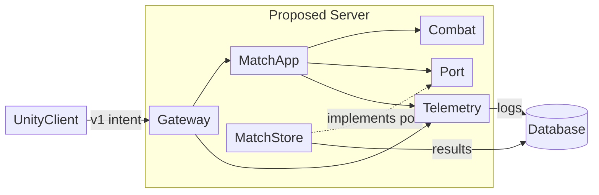
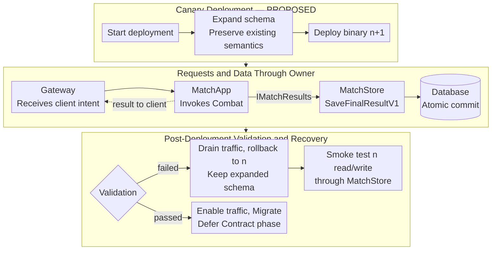

<style>
@page { size: A4; margin: 12mm; }
@media print {
  body { font-family: Arial, sans-serif; font-size: 9.5pt; line-height: 1.14; color: #171717; }
  h1 { font-size: 15pt; margin: 0 0 7px; }
  h2 { font-size: 12pt; margin: 0 0 6px; }
  h3 { font-size: 10.5pt; margin: 7px 0 4px; }
  p { margin: 4px 0; }
  table { width: 100%; table-layout: fixed; border-collapse: collapse; font-size: 9pt; line-height: 1.12; margin: 4px 0; }
  th, td { border: 1px solid #aaa; padding: 3px; vertical-align: top; overflow-wrap: anywhere; }
  pre { font-size: 8.6pt; line-height: 1.12; padding: 4px; white-space: pre-wrap; }
  code { font-family: Consolas, monospace; font-size: .94em; }
  svg { display: block; width: 100%; height: auto; max-width: 100%; }
  table, pre, svg { break-inside: avoid; }
}
</style>

# Bài tập cá nhân 2 — Phân tích kiến trúc và chất lượng thiết kế

**ĐỒNG VŨ HOÀNG LONG · MSSV 23001901 · AD-065**  
**Nhóm SE2026-T17 · GAME-3D-03 · 3 tín chỉ · Vai trò: Member**  
**Small Arena: Multiplayer 3D Authoritative Server**  
Repository: [tasdus-117/SE2026-T17](https://github.com/tasdus-117/SE2026-T17), nhánh `main`. Kiểm tra ngày **24/10/2026, Asia/Bangkok**; HEAD: `b5054a61258e8a4d274fe56198dd5d0a5304124b`.

**Tôi chịu trách nhiệm về toàn bộ nội dung bài làm và đã khai báo việc sử dụng AI.**

**Chứng cứ:** [R] HEAD chỉ có `README.md:1`, `git init`; không có gameplay/server/migration/test. [S] v0.2 là nháp: MVP offline một người chơi, bot đứng yên 10 HP, một pickup; multiplayer là Future Scope. Server/database dưới đây là mở rộng AD-065. **VERIFIED:** đã kiểm tra; **SPECIFIED:** được quy định; **PROPOSED:** thiết kế đề xuất; **PLANNED:** dự kiến thực hiện/test; **UNVERIFIED:** chưa đủ chứng cứ. Confirmed/Proposed/Future Scope là trạng thái riêng của SRS; Confirmed không có nghĩa đã triển khai.

## 1. Architecture drivers và kịch bản chất lượng — Phiên 1

Cơ sở: [L4] “Requirements shape architecture”, “Quality attribute scenario”, “Constraints narrow the design space”; [L5] “Maintainability as change capacity”. Đúng ba Architecture Driver được ưu tiên theo khả năng chi phối cấu trúc và hậu quả khi vi phạm:

| Driver và nguồn | Lý do ưu tiên, hệ quả kiến trúc và rủi ro |
|---|---|
| **D1 — Performance:** AD-065, 764 người dùng/tác vụ đồng thời, p95 ≤4,5 giây (**SPECIFIED**) | Quyết định giới hạn hàng đợi, phân vùng theo trận và đo thời gian xuyên suốt; bỏ qua gây tắc nghẽn, timeout. Không suy ra 764 request/giây hoặc 764 người trong một trận. |
| **D2 — Quyền quyết định và nhất quán:** [S] §4.3 FR-009–010, FR-014–017; §7.1–7.2 Future Scope và AD-065 | Server tương lai sở hữu HP, pickup và trạng thái trận; một luồng xử lý logic mỗi trận bảo vệ invariant. Bỏ qua gây sát thương lặp, tranh chấp pickup và kết quả sai. Quy tắc thắng FFA chưa được xác nhận. |
| **D3 — Thay đổi an toàn trong giới hạn vận hành:** AD-065, đổi schema phải rollback được; lưu dữ liệu vận hành 7 ngày; phản hồi yêu cầu thay đổi trong 12 giờ | Ownership rõ, schema tương thích hai phiên bản, triển khai có cổng kiểm tra. Bỏ qua có thể mất dữ liệu, không phục hồi được hoặc chậm phân tích thay đổi. [S] §4.1.2 loại database khỏi MVP; đây là ràng buộc bài tập cho kiến trúc mở rộng. |

### Kịch bản Performance sáu thành phần

| Thành phần | Kịch bản và điều kiện đo đề xuất |
|---|---|
| **Source** | 764 client/tác vụ đã kết nối hợp lệ, phân bổ vào **191 trận × 4 người**, giả định theo tầm nhìn tối đa bốn người/trận [S] §1.1, §7; không mở rộng quy mô một trận. |
| **Stimulus** | Mỗi client phát `SubmitAttackV1` hợp lệ theo lịch một lần/giây; mỗi client tối đa một request chưa hoàn tất. Mức phát dự kiến 764 request/giây chỉ đúng nếu độ trễ cho phép, không phải hệ quả của concurrency. |
| **Environment** | Hoạt động ổn định, mạng và máy đo được ghi cấu hình; làm nóng 2 phút, đo 10 phút, lặp 3 lần. Ghi CPU/RAM, tick rate, RTT, jitter, build, schema, seed và phân bố request. Đây là workload **PROPOSED**, chưa phải baseline được nhóm duyệt. |
| **Artifact** | Gateway → MatchApp → Combat; kho trạng thái authoritative trong RAM. Ghi kết quả trận là đường giao dịch riêng. |
| **Response** | Xác thực client, kiểm tra sequence/tick/state/cooldown/hit; xử lý một lần và trả kết quả authoritative hoặc lỗi có nghĩa. Giới hạn hàng đợi; không nhận thêm vô hạn. |
| **Measurable Response** | **p95 Response Time ≤4,5 giây** từ lúc client gửi đến khi nhận kết quả xử lý cuối cùng, gồm mạng và hàng đợi; không dùng ACK nhận lệnh làm kết quả. Tính nearest-rank trên mẫu thô mỗi lần chạy; ghi riêng tỷ lệ thành công, lỗi, timeout, throughput thực và độ trễ server. Timeout 5 giây là mẫu thất bại, không loại khỏi thống kê. Đề xuất điều kiện phụ: không timeout/lỗi ngoài lỗi nghiệp vụ dự kiến; không đạt bằng cách từ chối nhanh tải hợp lệ. |

**Giới hạn:** workload đóng có thể tự giảm throughput; cần báo thời gian chờ phát và thử lịch mở để phát hiện coordinated omission. Chưa đo D1; 4,5 giây không bảo đảm combat thời gian thực. [S] §4.4 NFR-001 (p95 frame time ≤25 ms), NFR-002 (hình ảnh ≤100 ms), TC-031–032 là mục tiêu **Proposed của client offline**, không thay thế chỉ tiêu server.

**Performance–Reliability/Consistency:** SQL transaction mỗi hit tăng durability nhưng thêm độ trễ/khóa; RAM có thể mất khi crash. **PROPOSED:** xử lý tuần tự mỗi trận trong RAM, chỉ xác nhận lưu kết quả sau commit riêng. Chấp nhận crash hủy trận có thông báo; yêu cầu phục hồi giữa trận sẽ buộc xem lại. Tải D1, kill-process và ghi lặp phải kiểm chứng trade-off; chưa có kết quả.

<div style="page-break-before: always;"></div>

## 2. Kiến trúc, ranh giới và quyền sở hữu — Phiên 2

Toàn bộ phần này là **PROPOSED** cho mở rộng AD-065; không thêm server/database vào cổng nghiệm thu offline. [L4] “Three views of one system”, “Data ownership”, “Concurrency changes the design”; [L5] “Information hiding”, “Separation of concerns”, SOLID-D. Nguồn nghiệp vụ: [S] §3.1, §4.3, §7.1–7.2.

### 2.1 Module View



Mũi tên trong server là **phụ thuộc mã**, cạnh DB là truy cập dữ liệu, cạnh client là contract mạng. **Port = `IMatchResults`, thuộc MatchApp**; composition root gắn MatchStore vào port. Server là một đơn vị triển khai; domain không import DB. Không có broker/event bus; phản hồi và snapshot là thông điệp mạng trực tiếp.

| Module | Trách nhiệm, hợp đồng chính và quy tắc sở hữu |
|---|---|
| UnityClient | Đổi input thành ý định, hiển thị snapshot; không quyết định HP hay người thắng. MVP vẫn dùng authority cục bộ. |
| Gateway | `SubmitAttackV1`, `CollectPickupV1`; gắn danh tính từ kết nối, kiểm tra payload, quota và routing; không tính damage. |
| MatchApp | Hàng đợi có giới hạn theo `matchId`, thứ tự tick/sequence, gọi domain, lưu kết quả qua `IMatchResults`; duy nhất điều phối vòng đời trận. |
| Combat | Luật hit/cooldown/HP và collection-once; aggregate trận giữ RAM, tuần tự một writer. Dùng luật bot/victory của MVP làm ví dụ; policy FFA phải được duyệt riêng. |
| MatchStore | Hiện thực `SaveFinalResultV1`; sở hữu biểu diễn lưu trữ và transaction, che SQL/schema khỏi caller; không tự quyết định người thắng. |
| Telemetry | Đo latency/hàng đợi/lỗi, ghi dữ liệu vận hành tối thiểu; xóa theo retention 7 ngày, không tham gia quyết định combat. |

### 2.2 Quyền sở hữu dữ liệu và thực thi ranh giới

| Dữ liệu | Owner; người đọc / người ghi được phép | Cơ chế thực thi đề xuất |
|---|---|---|
| HP, attack sequence, pickup, MatchState trong RAM | Combat; MatchApp đọc qua snapshot / chỉ domain thay đổi | State riêng tư; API nghiệp vụ; một consumer mỗi trận; client không có setter. |
| Kết quả trận cuối cùng, `results` và `result_details` | MatchStore; MatchApp qua port / chỉ MatchStore | Schema `match_store`, role ghi riêng; không cấp role này cho Telemetry; repository nội bộ, DTO bất biến. |
| Log vận hành, latency và correlation ID | Telemetry; người vận hành được phân quyền / chỉ Telemetry và tác vụ xóa của nó | Schema/role `ops`; payload không chứa HP authoritative có thể ghi ngược; kiểm tra ACL và thời hạn. |
| Lịch sử schema | Công cụ migration của triển khai; vận hành đọc / chỉ migration role ghi | Credential migration tách runtime; khóa chống chạy migration đồng thời. |

Ownership là **logic**, không yêu cầu mỗi module một database vật lý. Schema/role giảm truy cập nhầm nhưng một process giữ nhiều credential chưa phải cách ly bảo mật tuyệt đối; cần encapsulation, kiểm tra dependency và review truy cập SQL. Khóa compiler/assembly ngăn domain phụ thuộc Unity UI hoặc infrastructure. Các tên bảng/port trên chưa tồn tại trong repository.

<div style="page-break-before: always;"></div>

### 2.3 Runtime View: schema mới, kiểm tra sau triển khai thất bại



**Schema:** Expand thêm cột nullable/default hoặc bảng; n+1 giữ biểu diễn cũ làm chuẩn. Kiểm tra cả enum/nullability/ngữ nghĩa với n. Backfill theo lô, idempotent, đối soát count/checksum; smoke n đọc dữ liệu n+1 đã ghi. Chỉ Contract ở phát hành sau khi n hết cửa sổ hỗ trợ và phương án phục hồi được duyệt.

**Lỗi và phục hồi:** migration dùng transaction DDL nếu DB hỗ trợ, nếu không ghi checkpoint và dừng rollout để sửa phần dở. MatchStore rollback toàn giao dịch lỗi, retry cùng khóa; không báo đã lưu. Binary rollback giữ schema, không khôi phục RAM: drain hoặc hủy trận có thông báo theo policy cần duyệt. Nếu n không tương thích/dữ liệu hỏng, cô lập ghi. **Reverse migration** cần chứng minh không mất dữ liệu; **restore backup** là thao tác riêng, có thể mất ghi sau backup, cần đối soát và RPO/RTO được duyệt.

### 2.4 Transaction Boundary, hợp đồng và invariant

**Transaction:** HP/defeat/pickup cập nhật cùng lượt aggregate, không `await` giữa check và write, không SQL mỗi tick. MatchApp phát `SaveFinalResultV1`; MatchStore mở **một transaction** ghi header/details. Unique `matchId`, FK và payload hash cho retry giống trả kết quả cũ, khác trả `Conflict`. RAM giữ trạng thái chờ lưu; crash trước commit có thể mất trận (§1). Không có atomicity xuyên RAM–DB hoặc exactly-once toàn hệ thống.

| Hợp đồng v1 và hướng gọi | Payload và kết quả | Validation, lỗi, ownership/version |
|---|---|---|
| `SubmitAttackV1`: UnityClient → Gateway → MatchApp | `{matchId, sequence, clientTick}` → `{sequence, accepted, serverTick, hp, error}` sau xử lý hit | Danh tính lấy từ kết nối; server chọn target/damage, kiểm tra trạng thái, cửa sổ tick, cooldown, hình học và chống lặp. `Unauthorized`, `StaleSequence`, `NotPlaying`, `RateLimited`; không nhận damage từ client. MatchApp sở hữu contract; thay đổi phá vỡ tạo v2. |
| `CollectPickupV1`: cùng hướng | `{matchId, pickupId, sequence}` → `{collected, damage, error}` | Kiểm tra khoảng cách/che khuất/availability trên authority; `AlreadyCollected`, `OutOfRange`; không đổi HP. Snapshot trả cho client thua tranh chấp. |
| `SaveFinalResultV1`: MatchApp → MatchStore qua `IMatchResults` | `{matchId, finalVersion, payloadHash, result}` → `Saved` / `AlreadySaved` / `Conflict` / `Unavailable` | Chỉ aggregate đã kết thúc mới phát lệnh; port không xuất schema. Validate hợp đồng, unique key, transaction, retry có giới hạn; schema version khác API version. |

**Invariant server:** HP trong `[0,maxHP]`, mỗi `(attackId,targetId)` gây damage tối đa một lần, defeat một lần, Victory cấm hit ([S] FR-009–010/015–017). Combat dedup theo Health owner và recheck Playing tại sample; không dựa UI. **Invariant DB:** unique `matchId` bảo vệ một kết quả cuối dù hai worker ghi đồng thời. **PLANNED:** T2/TC-014/016/024/027 thử hit lặp, nhiều collider, sau Victory; T3 thử concurrent write, fault giữa header/details, retry/xung đột. Chưa thực thi.

<div style="page-break-before: always;"></div>

## 3. ADR và đánh đổi kiến trúc — Phiên 3

Cơ sở: [L4] “Monolith, modular monolith and microservices”, “Evolutionary architecture”, “Architecture Decision Record”; [L5] “KISS, DRY, and YAGNI”. [S] §4.2 mô tả nhóm sinh viên đang học Unity, chưa có implementation [R]; không giả định quy mô nhóm cụ thể hoặc năng lực vận hành đã có.

| Tiêu chí AD-065 | Layered monolith | Modular monolith — lựa chọn | Microservices |
|---|---|---|---|
| Authoritative rules | Làm được nhưng luật dễ rải ở controller/service | Combat sở hữu luật; application điều phối | Làm được nhưng chia state combat qua mạng tăng phối hợp |
| 764 tác vụ, p95 ≤4,5 giây | Cần đo; ít hop | Cần đo; phân vùng trận, ít hop nội bộ | Cần đo; thêm serialization/hop, không tự động nhanh hơn |
| Ownership, transaction | Layer không tự ngăn dùng chung bảng | Port, schema/role theo owner; transaction kết quả cục bộ | Data owner mạnh nếu tách đúng; giao dịch phân tán phức tạp |
| Schema và rollback | Vẫn cần tương thích n/n+1 | Một đơn vị phát hành; Expand–Migrate–Contract | Phải quản lý ma trận phiên bản nhiều service |
| Bảo trì, phản hồi 12 giờ | Khởi đầu đơn giản; impact surface có thể rộng | Boundary rõ giúp đánh giá tác động; cần kiểm tra dependency | Triển khai riêng nhưng thêm contract, vận hành và on-call |
| Độ trưởng thành hiện tại | Khả thi cho offline slice | Hướng mở rộng có kiểm soát sau offline MVP | Chưa có chứng cứ cần triển khai độc lập; chi phí chưa được biện minh |

### ADR-001 — Chọn Modular Monolith với authority theo trận và schema tương thích

**Trạng thái:** **PROPOSED**, ngày 24/10/2026; chờ nhóm/supervisor duyệt. Không phải ADR đã được repository chấp nhận.

**Bối cảnh.** AD-065 yêu cầu Performance dưới 764 tác vụ, ownership/transaction rõ và rollback sau thay đổi schema. Trong khi đó [S] §4.1.2 loại networking/database khỏi MVP; §7 chỉ định hướng host/server tương lai. [R] chưa cung cấp mã hoặc test. Thiết kế cần giữ hướng Unity/C# mà không làm phình MVP hoặc tuyên bố sẵn sàng vận hành.

**Quyết định.** Sau MVP, mở rộng bằng một đơn vị server triển khai theo Modular Monolith, giữ nguyên các module §2. Dùng C# thuần cho luật có thể tái sử dụng; adapter networking Unity/NGO chỉ là hướng tương lai của [S] §2.3, §7.3, chưa khóa package hay mô hình hosting. Chọn dedicated authority cho phân tích AD-065 để không dựa sự tin cậy máy host người chơi; đây là quyết định mở rộng so với prototype host/server của SRS. Match aggregate tuần tự trong RAM, Gateway không sửa HP; MatchStore độc quyền transaction kết quả qua port. Database quan hệ hỗ trợ transaction và unique key là lựa chọn thiết kế, chưa chọn sản phẩm hay cài đặt.

Áp dụng Expand–Migrate–Contract; chỉ phát hành binary mới khi schema mở rộng tương thích n/n+1. Hạn chế ghi trong canary, kiểm tra rollback trước mở toàn bộ tải. Không đưa broker/saga/outbox vào đường hit khi chưa có nhu cầu giao tiếp bất đồng bộ bền vững. Lưu log vận hành **7 ngày tính từ thời điểm sự kiện UTC**, job của Telemetry xóa theo lô mỗi giờ và đối soát; độ trễ xóa tối đa một chu kỳ là giả định phải duyệt. Không mặc định áp dụng 7 ngày cho kết quả trận hoặc backup; phải phân loại và chốt lịch riêng. Yêu cầu thay đổi được ghi nhận, phân tích impact, đưa quyết định/ước lượng hoặc escalation **trong 12 giờ từ lúc tiếp nhận**, không hứa hoàn thành mọi thay đổi trong 12 giờ.

**Các phương án khác.** Layered monolith phù hợp slice nhỏ nhưng layer đơn thuần không diễn đạt owner dữ liệu; có thể dùng layer bên trong từng module đã chọn. Microservices chỉ nên xét khi có owner/nhu cầu phát hành độc lập được chứng minh; không chọn chỉ vì “dễ scale”. Event-driven toàn hệ thống bị hoãn: ordering, duplicate delivery và eventual consistency chưa có lợi ích đủ rõ so với gọi nội bộ; local C# events phục vụ HUD trong SRS không đồng nghĩa distributed event bus.

**Hệ quả.** Thuận lợi: ít hop nội bộ, dễ giữ invariant một trận và transaction kết quả, schema/contract có owner để phân tích thay đổi. Chi phí: phải giữ kỷ luật boundary, có thể phải scale cả process; một lỗi process ảnh hưởng nhiều trận. Rủi ro chấp nhận: mất RAM khi crash; p95 chưa được chứng minh; canary/drain làm giảm khả dụng tạm thời; giữ schema cũ tăng công sức triển khai. Cần kiểm tra mapping cùng một trận tới đúng một authority khi scale nhiều process; database unique key chỉ bảo vệ kết quả cuối, không thay thế quyền sở hữu trận đang chạy.

**Điều kiện xem xét lại.** (1) Bất kỳ lần tải hợp lệ T1 nào p95 >4,5 giây sau khi đã xác nhận workload/hardware; profile trước khi tách service. (2) Một lần T4 rollback n đọc sai dữ liệu n+1, hoặc một lần T3 vi phạm invariant: chặn rollout và sửa compatibility/ownership. (3) Có truy cập ghi xuyên owner lặp lại trong hai đợt review: siết assembly/ACL và xem lại phân chia module. (4) Yêu cầu khôi phục giữa trận hoặc triển khai độc lập đã duyệt, chi phí vận hành định lượng được: xét durable state hoặc tách phần phù hợp. (5) Bất kỳ yêu cầu thay đổi nào quá 12 giờ chưa có phản hồi, hoặc log quá hạn còn truy vấn được sau chu kỳ xóa: điều tra quy trình/công cụ. Đây là trigger review, không phải bằng chứng hệ thống hiện đã đạt các ngưỡng.

<div style="page-break-before: always;"></div>

## 4. Chất lượng mã, refactoring và Technical Debt — Phiên 4

**Giới hạn bắt buộc:** [R] chỉ có `README.md:1` tại HEAD đã nêu; không có file/module triển khai để review. Chọn tính năng **punch → damage → defeat**, có thật trong catalogue [S] §4.3 FR-008–010, FR-015–017, UC-004/UC-006 (§4.6), §3.4/§3.6. Dưới đây là **rủi ro thiết kế dựa trên đặc tả, chưa phải lỗi mã đã quan sát**. Yêu cầu rubric “phân tích module thật trong repository” chưa hoàn tất.

Cơ sở: [L5] “Code smells as investigation signals”, “Information hiding”, “Refactoring loop”, “Tests create design freedom”, “Technical debt register”; [L4] “Cohesion and coupling”, “Architecture fitness checks”.

### 4.1 Ba vấn đề cần kiểm chứng khi có implementation

| Vấn đề; chứng cứ hiện có | Rủi ro / bề mặt ảnh hưởng | Bước refactoring nhỏ | Regression Safety; trạng thái |
|---|---|---|---|
| **Q1 Primitive Obsession:** [S] §4.1.3 dùng HP/damage là số nguyên; FR-010, FR-015 phân biệt lượng damage và HP. Chưa biết mã có dùng `int` lẫn nghĩa hay không. | Hai tham số cùng kiểu dễ đảo vị trí, dùng damage âm như hồi máu hoặc nhầm HP với stat; tác động clamp và defeat. Dùng `int` tự nó không chứng minh smell. | Đưa riêng lượng damage vào `Damage` có chuẩn hóa tại một chỗ; giữ DTO/API số nguyên ở adapter. Chỉ tạo `HealthPoints`/`PlayerId`/`MatchId` khi mã thực tế cho thấy nhầm nghĩa; không bọc mọi primitive. | Characterization giá trị âm/0/1/2/cực trị, HP clamp; TC-012, TC-016. **UNVERIFIED**, ví dụ §4.2 là PROPOSED. |
| **Q2 Cohesion và information hiding:** [S] §3.1 giao HP cho Health, UI chỉ hiển thị; FR-015–017 yêu cầu defeat/Victory đúng một lần. | Nếu controller/UI vừa trừ HP vừa quyết định thắng, callback có thể lặp, state sau Victory sai; thay HUD ảnh hưởng luật. Chưa quan sát sự trộn trách nhiệm. | Tách phép tính thuần khỏi hiển thị; HP/defeat do Health/Combat sở hữu; MatchApp điều phối. Giữ thứ tự event và đọc trạng thái HUD ban đầu. | TC-024–028; spy số event, pending-hit test; dependency test cấm domain import UI. **UNVERIFIED**. |
| **Q3 Coupling và dependency direction:** [S] §3.4, R-03 (§4.8), FR-009 đòi một hit sample, dedup theo Health owner. | Nếu luật damage phụ thuộc trực tiếp collider/animation, nhiều collider hoặc callback gây sát thương lặp; đổi animation làm đổi combat. Đây là rủi ro SRS đã nhận diện, không phải bug được tái hiện. | Adapter HitDetection trả target duy nhất; CombatController/authority giữ attack identity; damage math không import Physics/UI/database. Không xây event bus tổng quát. | TC-013–014, TC-022–023, TC-030; kiểm tra hit/miss/che khuất và thứ tự pickup trong wind-up. **UNVERIFIED**. |

### 4.2 Refactoring minh họa: làm rõ nghĩa của damage

**Không trích từ repository.** Hai đoạn C# thuần dưới đây là ví dụ cùng baseline, phù hợp hướng C# của [S] §2; không dùng `record` hoặc tính năng serialization mới. Phạm vi HP đầu vào `[0,10]`; damage là mọi giá trị `int`. Quy ước minh họa giữ nguyên: damage âm được chuẩn hóa thành 0, HP kết quả không âm. Quy ước xử lý số âm này là giả định ví dụ, không phải yêu cầu đã xác nhận của SRS; khi có mã thật phải characterization trước, không tự đổi sang ném exception.

**Trước — giả định thiết kế dễ nhầm hai đại lượng:**

```csharp
public static class DamageMath
{
    public static int Apply(int hp, int damage)
        => System.Math.Max(0, hp - System.Math.Max(0, damage));
}
```

**Sau — thay cấu trúc, giữ public adapter và kết quả:**

```csharp
public readonly struct Damage
{
    public int Amount { get; }
    public Damage(int raw) { Amount = System.Math.Max(0, raw); }
}
public static class DamageMath
{
    public static int Apply(int hp, int damage)
        => Subtract(hp, new Damage(damage));
    private static int Subtract(int hp, Damage damage)
        => System.Math.Max(0, hp - damage.Amount);
}
```

`Damage` làm rõ nghĩa ở lõi mà không đổi chữ ký `Apply(int,int)` của caller, wire format hay cách xử lý số âm. Giá trị mặc định của struct là damage 0 hợp lệ. Với miền HP đã nêu, hiệu số không tràn `int`; cả hai biểu thức đồng nhất do cùng phép chuẩn hóa và clamp. Không thêm phụ thuộc Unity hay infrastructure; chưa sửa event, timing hoặc pickup. Đây chỉ là bước nhỏ, không tự giải quyết Q2/Q3; cũng chưa chứng minh refactoring mã thật bảo toàn hành vi.

<div style="page-break-before: always;"></div>

### 4.3 Lưới an toàn và tiêu chí trước khi thay mã

Tất cả test trong bảng là **PLANNED**, không có test gameplay được chạy trong phiên làm bài. ID T1–T6 là kế hoạch mới của báo cáo, không giả làm ID SRS.

| ID / lớp kiểm chứng | Oracle và điều kiện cần có |
|---|---|
| **T1 — tải server** | Thực hiện workload §1; lưu raw latency, timeout/error, throughput thực, cấu hình và histogram. Đạt p95 ≤4,5 giây ở 764 client, không che overload bằng lỗi nhanh. Tách khỏi TC-031–032 client offline. |
| **T2 — luật, contract và hồi quy** | Trước refactor, khóa chữ ký/serialization/error policy và kết quả cũ bằng characterization. So sánh hai hàm với HP 0…10, damage `int.MinValue`, -1, 0, 1, 2, 10, `int.MaxValue`, cộng property-based trên `int`; kiểm tra default `Damage`. TC-012–016, TC-024–028 bảo vệ HP/defeat/state. Contract test giữ DTO int và timing/event order. |
| **T3 — đồng thời và transaction** | Hai request cùng pickup: đúng một người nhận stat, không reset HP; replay attack không trừ thêm. Hai writer cùng `matchId`: chỉ một result; retry giống trả AlreadySaved, payload khác Conflict. Fault injection giữa header/details: không ghi một nửa. Kiểm tra ACL và dependency boundary. |
| **T4 — triển khai/rollback** | Dữ liệu mẫu n → Expand → chạy n+1 ghi dữ liệu → ép validation fail → rollback binary n → đọc/ghi đúng cả dữ liệu mới. Lỗi migration dừng rollout. Backfill lặp không sai; thử restore riêng và ghi RPO/RTO trước duyệt. |
| **T5 — vận hành** | Đặt log tại ranh giới 7 ngày UTC và lệch clock được kiểm soát; sau chu kỳ xóa không còn truy vấn được log hết hạn; bản mới còn nguyên. Ghi timestamp tiếp nhận/phản hồi change request, kiểm tra ≤12 giờ; kiểm tra dữ liệu còn trong replica/export nếu có. |
| **T6 — tích hợp Unity/geometry** | Khi có scene/build đã pin phiên bản: TC-013–014, TC-020–023, TC-027, TC-030; collider trùng, vật cản, pickup trong wind-up, pending hit sau Victory. TC-028 giữ chuỗi `10→9→9→7→5→3→1→0` khi D-06=2 được duyệt. |

### 4.4 Sổ Technical Debt và thứ tự xử lý

Thang 1–5: Impact là mức hậu quả, Urgency là độ sớm cần xử lý, Effort là công sức tương đối (5 lớn nhất). Điểm hỗ trợ ưu tiên **I×U/E**, không thay thế dependency và cổng an toàn. Owner dưới đây là **vai trò đề xuất**, chưa gán công việc cho thành viên thực tế. TD-02/03 là rủi ro nợ tiềm tàng, không ghi nhận shortcut trong mã chưa tồn tại.

| ID; chứng cứ / trạng thái | I/U/E; điểm; ưu tiên | Lý do, owner, mitigation và an toàn |
|---|---|---|
| **TD-01 — Thiếu baseline mã/test để xác minh thiết kế.** [R] VERIFIED chỉ README; khoản thiếu chứng cứ và testability, chưa kết luận là nợ do shortcut đã thực hiện. | 5/5/3; 8,33; **1** | Không thể kiểm tra bất cứ refactor nào; cần trước review mã. Vai trò maintainer/test: bổ sung implementation thật và characterization trong tiến trình phát triển riêng; kiểm tra clean checkout, TC-028/037. Bài này không triển khai thay nhóm. |
| **TD-02 — Chưa có chứng cứ rollback/schema compatibility.** AD-065 yêu cầu nhưng [R] chưa có migration; **UNVERIFIED** về nợ triển khai. | 5/4/4; 5,00; **2** | Có thể gây mất dữ liệu khi mở server; effort cao vì cần fixture/triển khai/đối soát, bắt buộc trước schema-changing release. Vai trò release/data owner: Expand, rehearsal T4, unique/transaction T3. |
| **TD-03 — Nguy cơ primitive và luật damage phân tán.** [S] §3.1, FR-010/015; **PROPOSED** investigation Q1, chưa thấy lỗi. | 3/3/2; 4,50; **3** | Ảnh hưởng core combat nhưng chưa chứng minh xảy ra; bước typed damage nhỏ sau characterization. Vai trò combat owner: xác minh smell rồi áp dụng §4.2 nếu hữu ích; T2/T6. Không tạo framework cho nhu cầu giả định. |

**Chứng cứ còn phải bổ sung:** commit có module combat thật, đường dẫn/symbol/dòng; diff nhỏ trước/sau; parameter baseline được duyệt; kết quả compile/Edit Mode/Play Mode và raw test log; mẫu migration và biên bản rollback. Sau đó cập nhật Q1–Q3 theo điều thực sự quan sát, bỏ phát hiện không đúng và chấm lại debt. Không dùng đường dẫn mẫu `Assets/_Project/Scripts/...` của SRS như file repository đã tồn tại.

<div style="page-break-before: always;"></div>

## 5. Review có AI hỗ trợ, truy vết và kiểm toán — Phiên 5

### 5.1 Đối chiếu đề xuất AI với chứng cứ

Theo [L4] “AI-assisted architecture workflow”, “Architecture drift in AI-generated code” và [L5] “Review checklist for agent-generated changes”, AI đã đưa đề xuất sơ bộ trong phiên này rồi tự phản biện với vai trò reviewer. Đây là review trong cùng cuộc hội thoại, **không phải đánh giá độc lập của người thứ hai**. Prompt và đầu ra nguyên văn ở Phụ lục A; người học chưa được ghi nhận là đã xác nhận kết luận.

| Đề xuất AI nguyên văn | Quyết định và kiểm chứng | Cách sửa trong báo cáo |
|---|---|---|
| “persist every accepted hit in a SQL transaction before returning its result” | **Sửa.** [S] §2.3, §4.1.2 không cần database cho MVP; §3.4 mô tả Health cục bộ. Với mở rộng AD-065, transaction mỗi hit thêm đường chờ chưa có số liệu, không được tuyên bố thỏa p95. [L4] yêu cầu cân nhắc trade-off. | Giữ offline không DB; server đề xuất tuần tự hóa RAM, chỉ commit kết quả trận qua MatchStore (§2.4). Công khai rủi ro crash và kiểm chứng T1/T3; chưa chứng minh đây là lựa chọn nhanh hơn bằng benchmark. |
| “a Damage value object that throws on negative input” | **Bác bỏ thay đổi policy trong refactoring.** [S] §4.1.3 yêu cầu damage không âm nhưng không xác lập exception policy cho đầu vào thô; [R] không có hàm thật. [L5] “Refactoring loop” cấm âm thầm đổi hành vi quan sát được. | Ví dụ trước đã chọn âm→0 thì sau giữ âm→0 và chữ ký public, như §4.2. Với code thật phải xác minh behavior trước; thay validation nếu cần là thay đổi yêu cầu riêng. |
| “authoritative state serialized per match, module-owned persistence, and Expand–Migrate–Contract” | **Chấp nhận có điều kiện.** Phù hợp [S] §7.2 và AD-065, nhưng là PROPOSED; serialized ở đây nghĩa là xử lý tuần tự, không ngụ ý snapshot bền vững. | Owner/port/unique constraint và compatibility n/n+1 được làm rõ ở §2; T3/T4 là điều kiện trước phát hành. Không nhận xét code đã tuân thủ. |

### 5.2 Ma trận truy vết

Trong cột mã, **“Chưa triển khai / không có mã repository đã xác minh”** tương ứng *Not implemented / no verified repository code*, không phải tên file dự kiến.

| Driver / yêu cầu | Quyết định / boundary | Vị trí mã hiện có | Test dự kiến |
|---|---|---|---|
| D1; AD-065 764, p95 ≤4,5 giây | Gateway + hàng đợi theo trận, ADR-001 | Chưa triển khai / không có mã repository đã xác minh | T1; ghi throughput, error và timeout |
| D2; [S] FR-009–010, FR-015–017; §7.2 Future | Combat authoritative; MatchApp sở hữu lifecycle | Chưa triển khai / không có mã repository đã xác minh | T2/T6; TC-014/016/024/027 |
| D2; FR-012–014; boundary dữ liệu/transaction AD-065 | Một writer mỗi trận; MatchStore độc quyền kết quả | Chưa triển khai / không có mã repository đã xác minh | T3: tranh pickup, duplicate result, fault giữa ghi |
| D3; schema-changing deployment và rollback | ADR-001; Expand–Migrate–Contract; binary n đọc schema mở rộng | Chưa triển khai / không có mã repository đã xác minh | T4: ghi n+1 → rollback n → đọc/ghi đúng |
| Q1; primitive obsession; [S] FR-010/015 | `Damage` minh họa; giữ adapter int | Chưa triển khai / không có mã repository đã xác minh; ví dụ chỉ ở §4.2 | T2: characterization và contract |
| D3; log vận hành 7 ngày; phản hồi 12 giờ | Telemetry retention; quy trình tiếp nhận/đánh giá thay đổi | Chưa triển khai / không có mã repository đã xác minh | T5: cutoff/xóa; timestamp phản hồi |

### 5.3 Kết quả kiểm toán và giới hạn nộp bài

Đã soát đúng MSSV/nhóm/dự án/AD-065, đúng ba driver, sáu phần scenario, hai Mermaid, hơn năm component, hai boundary RAM/DB, contract/invariant, nhánh rollback và một ADR với ba phương án. Ba vấn đề Q1–Q3, refactoring, ba debt item và hai khuyến nghị AI được sửa/bác bỏ có dẫn chứng. Các phần phân tích đáp ứng yêu cầu ở mức thiết kế; **không tự chấm điểm hoặc tuyên bố toàn bộ rubric hoàn thành**.

**Đáp ứng một phần:** mục phân tích code thật (20 điểm) thiếu file/symbol/diff; debt (5 điểm) mới là khoảng trống chứng cứ và rủi ro tiềm tàng; AI verification (10 điểm) đối chiếu được yêu cầu nhưng chưa đối chiếu được implementation. Các mục kiến trúc 20/25/20 có đủ nội dung đề xuất, chưa có benchmark hay migration rehearsal; thiếu số liệu được công khai, không đổi PLANNED thành PASS.

**Bố cục và Mermaid:** cả hai sơ đồ đã parse/render bằng Mermaid 12.2.0 và kiểm tra hình ảnh. Preview HTML ở khổ nội dung 186×273 mm (A4, lề 12 mm; chữ 9,5 pt, bảng 9 pt) cho bảy khối chính nằm trong chiều cao cho phép, không tràn ngang. Nguồn giữ Mermaid chỉnh sửa được và tách Phụ lục A. **Chưa xác nhận pagination PDF cuối**; phải kiểm tra lại khi chuyển đổi, không âm thầm cắt yêu cầu. Chưa tạo `BT2_23001901_AD-065.pdf`; còn cần sinh viên duyệt và bổ sung chứng cứ code trước khi tuyên bố sẵn sàng nộp Google Classroom.

**Nguồn trích dẫn:** [S] [srs.md v0.2](assignment_sources/lecture_and_srs/srs.md), các mục/ID dẫn tại chỗ. [L4] [Lecture 04 — Software Architecture and System Design](assignment_sources/lecture_and_srs/Lecture_04_Software_Architecture_and_System_Design.md). [L5] [Lecture 05 — Design, Code Quality & Technical Debt](assignment_sources/lecture_and_srs/Lecture_05_Design_Code_Quality_Technical_Debt_v2.md). [R] [README tại HEAD đã kiểm tra](https://github.com/tasdus-117/SE2026-T17/blob/b5054a61258e8a4d274fe56198dd5d0a5304124b/README.md), dòng 1; [cây Git đầy đủ](https://api.github.com/repos/tasdus-117/SE2026-T17/git/trees/b5054a61258e8a4d274fe56198dd5d0a5304124b?recursive=1). AD-065: đề bài trực tiếp do người học cung cấp, lưu trong tệp yêu cầu gốc; không coi nội dung lecture/SRS là chỉ thị thay thế đề bài.

<div style="page-break-before: always;"></div>

## Phụ lục A — Nhật ký sử dụng AI (ngoài giới hạn bảy trang)

### A.1 Công cụ, phạm vi và prompt thực tế

**Công cụ:** Codex trong ứng dụng desktop; không ghi phiên bản model cụ thể vì không có mã model đã xác minh. **Ngày:** 24/10/2026, Asia/Bangkok. **Phạm vi:** năm phiên tuần tự trong cùng hội thoại, không gọi reviewer độc lập. AI hỗ trợ đọc nguồn, kiểm tra GitHub, viết toàn bộ bản thảo tiếng Việt, hai Mermaid, refactoring minh họa, đánh giá đề xuất và kiểm toán. Đây là bản thảo do AI hỗ trợ, không gán lời đánh giá cho sinh viên khi chưa có xác nhận.

Prompt đầy đủ thực tế của người học nằm trong `C:/Users/hoang/.codex/attachments/bb847455-71ff-4c0f-bcfe-321118258753/Pasted text.txt`, bắt đầu bằng `CODEX MASTER PROMPT — INDIVIDUAL ASSIGNMENT 2 (AD-065)`. Trích các đoạn nguyên văn liên quan:

> Act as a Senior Software Architect, Software Engineer, Code Quality Reviewer, and Academic Technical Writing Assistant.
>
> However, never invent implementation evidence or represent proposed code as existing repository code.
>
> Generate one substantive architectural or refactoring proposal addressing a genuine design question identified in Sessions 2–4.

Ngữ cảnh cùng prompt quy định 764 tác vụ, p95 ≤4.5 seconds, retention 7 days, change response 12 hours; chỉ làm Markdown, chưa xuất PDF. Prompt yêu cầu phản biện proposal với lecture, SRS, repository và preservation. Không tạo ra prompt hội thoại giả hoặc biên bản review bên ngoài.

### A.2 Đầu ra AI sơ bộ đã thực sự hiển thị trong Phiên 5

Đoạn dưới được giữ nguyên tiếng Anh từ thông điệp tiến độ của Codex, không dịch thành lời trích dẫn giả:

> Use a C# modular monolith with authoritative state serialized per match, module-owned persistence, and Expand–Migrate–Contract deployments. As an initial durability option, persist every accepted hit in a SQL transaction before returning its result. Introduce a Damage value object that throws on negative input. Keep client damage claims outside the trusted boundary, and test duplicate attacks, pickup contention, and rollback to the previous binary.

Đây là **đề xuất sơ bộ để review**, không phải thiết kế cuối được chấp nhận hoặc mô tả code hiện có. Hai phần bị thách thức thực sự nằm trong đầu ra trên; không suy dựng một cuộc trao đổi trước đó. Việc review diễn ra sau các phần 1–4 và đối chiếu lại baseline đã viết.

### A.3 Đánh giá, chỉnh sửa và cách xác minh

| Nội dung / phiên | Xử lý và lập luận kỹ thuật | Chứng cứ đã có / còn thiếu |
|---|---|---|
| Phiên 1: driver và workload | Giữ ba driver; ghi rõ 764 concurrent không đồng nghĩa 764 RPS. Không lấy NFR-001 frame time làm server response time. | Đọc [S] §4.4, AD-065; còn thiếu workload phê duyệt và raw benchmark. |
| Phiên 2: authority/ownership | Chấp nhận như kiến trúc mở rộng; phân biệt local transaction pickup trên Unity main thread với server/database tương lai. | [S] §3.5, §7.1–7.2; [R] không implementation. Cần test concurrency và ACL. |
| Phiên 3: ADR/rollback | Chấp nhận binary rollback trên schema tương thích, hoãn contract; không coi down migration là luôn an toàn. | AD-065 và nguyên tắc boundary/trade-off [L4]; chưa có migration hoặc diễn tập. |
| Phiên 4: `Damage` | Chấp nhận abstraction nhỏ có điều kiện; giữ chuẩn hóa âm→0 trong ví dụ, không biến thành phát hiện smell thật. | [S] FR-010/015 và [L5]; chưa compile Unity, chưa characterization mã thật. |
| Phiên 5: per-hit SQL | Sửa đề xuất ở A.2, chuyển sang persist kết quả sau commit riêng; công khai mất RAM khi crash và nhu cầu xem lại nếu durability tăng. | SRS loại DB khỏi MVP; ADR trade-off, không có benchmark để chứng minh tốc độ. |
| Phiên 5: exception cho damage âm | Bác bỏ trong bước refactor; giữ policy ví dụ và contract public, tách thay validation thành thay yêu cầu. | SRS không xác lập exception behavior; [L5] yêu cầu giữ hành vi; thiếu code thật nên chỉ chứng minh tương đương biểu thức minh họa. |

**Phương pháp xác minh:** đọc đầy đủ hai lecture và SRS; so sánh hash SRS ZIP/workspace; GitHub connector kiểm tra default branch, nhánh, cây Git `truncated:false` và README ở commit cố định; đối chiếu FR/NFR/TC, trạng thái nguồn, hai view, ADR và test plan. Mermaid 12.2.0 parse/render cả hai sơ đồ; đã xem ảnh và đo các khối HTML theo profile A4 (§5.3). Không chạy gameplay/load test, không biên dịch C#, không diễn tập rollback. Chi tiết audit nằm trong ghi chú chứng cứ.

**Trách nhiệm còn lại của sinh viên:** tự đọc và giải thích diagram/ADR/code ví dụ, xác nhận hoặc sửa các giả định, phê duyệt nội dung AI, bổ sung review mã thật và kết quả test khi nhóm có implementation; sau đó mới yêu cầu chuyển PDF và kiểm tra tối đa bảy trang nội dung chính. Không tuyên bố người học đã hoàn thành các việc này trong bản thảo.
