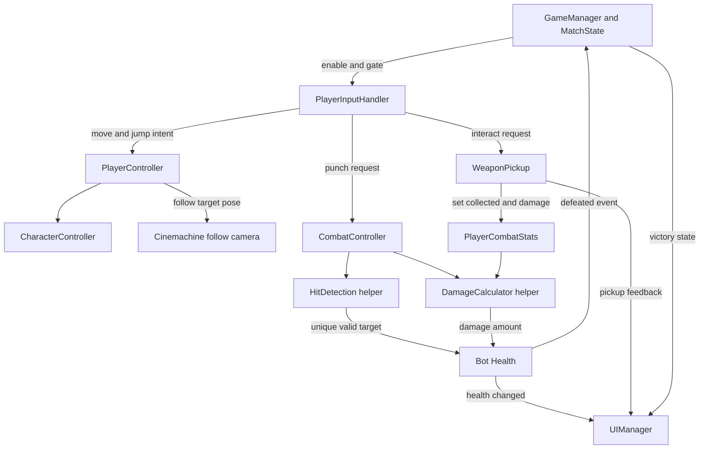
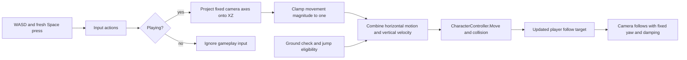
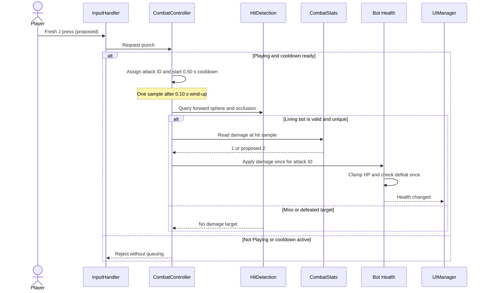
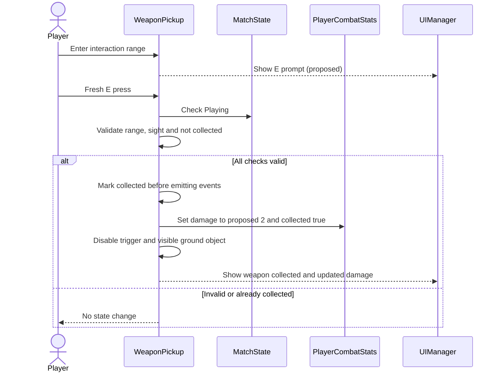
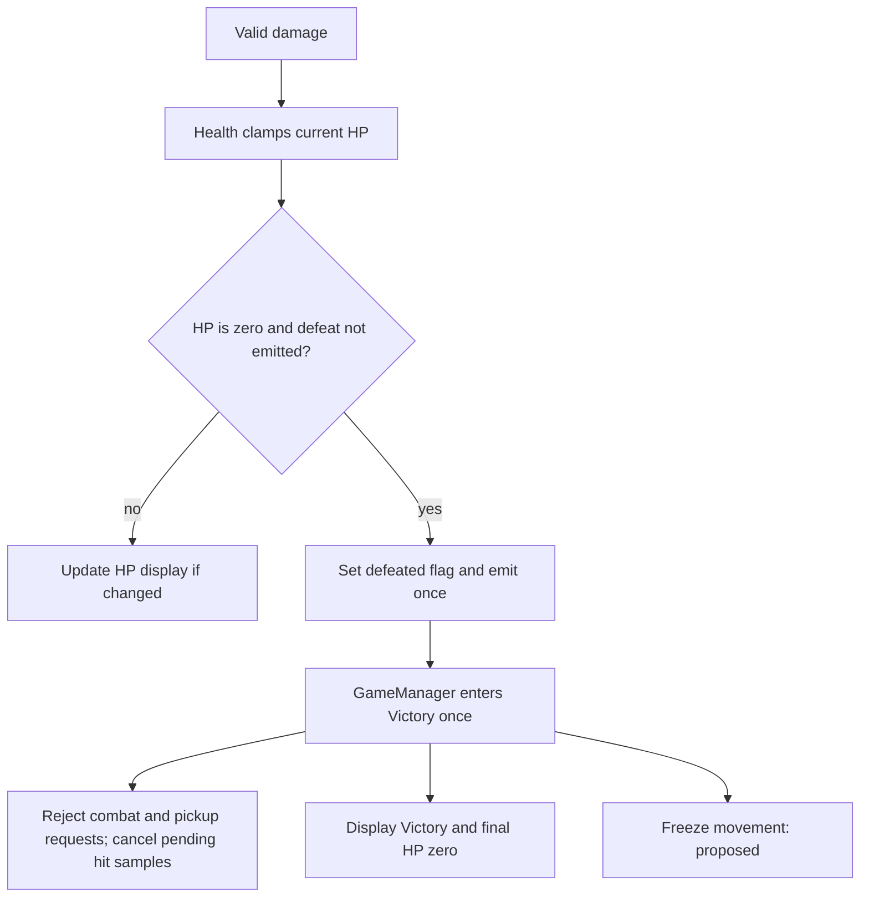
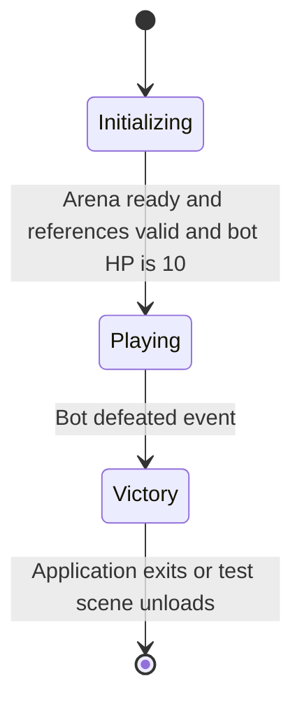

# Small Arena — SRS và đối chiếu kế hoạch TV2

Phiên bản 0.4, 2026-11-02 (Asia/Bangkok). [Phân công nhóm](../docs/SE2026-T17-Huong-dan-va-phan-cong-nhom.md) đã được đọc toàn bộ và là nguồn ưu tiên về trách nhiệm TV2 theo chỉ thị owner trong update_prompt_1.md. Đây là **kế hoạch cá nhân được phép cập nhật**, không chứng nhận cả nhóm/giảng viên duyệt mọi đề xuất. Unity/C# đã xác nhận; Mirror/server riêng/raycast/respawn là hướng PROPOSED theo phân công, chưa có phiên bản cài đặt hoặc gameplay chạy được.

## Phạm vi áp dụng và quyền sở hữu nguồn

Phần v0.4 này là đặc tả đề xuất phục vụ TV2; v0.3 online và v0.2 offline được lưu nguyên phía dưới. Baseline v0.3 bị superseded **trong kế hoạch cá nhân này**, không tuyên bố đã hủy yêu cầu được duyệt của toàn nhóm. Chưa có baseline gameplay mới được cả nhóm phê duyệt để triển khai. Không áp dụng đồng thời melee/elimination và raycast/respawn như một MVP lớn hơn.

SRS sở hữu nghĩa yêu cầu và quyết định gameplay; [TASKS](../docs/TASKS.md) sở hữu công việc/trạng thái; [ROADMAP](../docs/ROADMAP.md) sở hữu M0–M6/phối hợp; [PROTOCOL](../docs/PROTOCOL.md) sở hữu contract; [TESTING](../docs/TESTING.md) sở hữu ca thử/bằng chứng; learning chỉ sở hữu kết quả học. Không tạo TV2 plan riêng. Tất cả đường dẫn Unity dưới đây là dự kiến, chưa tồn tại.

## Đối chiếu xung đột và cách xử lý

| Nguồn/section cũ | Hướng dẫn phân công | Tác động TV2 | Xử lý trong kế hoạch cá nhân | Quyết định nhóm còn lại |
| --- | --- | --- | --- | --- |
| ARCHITECTURE / Khuyến nghị NGO + UTP + MPS | Unity + Mirror | Domain tách adapter mạng | Mirror PROPOSED; dừng khuyến nghị NGO như hướng hiện hành | TECH-001: release/Editor/transport tương thích, license và build |
| FR-107/110/111; F-008/010 melee và 2x weapon | Một súng raycast | Cooldown/range/damage, server raycast | FR-203/204 mới; melee/2x không là nghĩa vụ TV2 mới | Súng/aim và ammo có hay không |
| FR-108/109/114 elimination/ring-out/spectator | HP, chết, hồi sinh, điểm hạ | State machine và kill credit mới | FR-205–207; không dùng last-survivor làm điều kiện thắng mặc định | Respawn, credit, kết thúc trận/hòa |
| FR-101/105/113 và topology host+3 | Server chạy riêng trên máy nhóm, clients kết nối | TV2 cung cấp rules cho server TV1 | FR-201; không tự triển khai hosting/network | OS server, cách truy cập, xử lý server mất |
| FR-102 jump và fixed-heading camera | Đi/chạy, xoay; nhảy bổ sung | Chỉ quy tắc movement M1 | Nhảy không bắt buộc; camera do TV3 phối hợp chốt | Góc nhìn/aim/controller; có làm nhảy sau không |
| FR-110/111 pickup/E drop/knockback | Không thiết lập các cơ chế này | Không viết rule/test bắt buộc cho chúng | Ngoài kế hoạch TV2 đợt này; không tự nhập lại | Nếu cần, yêu cầu mới và scope riêng |
| FR-104 private code và đúng 4 mới start | Một phòng tối đa 4; M2 demo đủ 4/ready | TV2 cần điều kiện vào Playing | Không suy demo 4 thành minStart=4; không buộc room code | Số tối thiểu start; cách join/ready với TV1+TV3 |
| AGENTS / Git cá nhân so với phân công §7 main/PR | Quy trình nhóm là đề xuất | Không thay đổi quyền Git | Giữ long23001901 và mọi approval gate | Đích PR nhóm cần chốt sau; không thao tác Git theo ví dụ |

## Yêu cầu đề xuất mới — chưa triển khai, chưa duyệt toàn nhóm

Mọi FR-201–209 là PROPOSED, implementation TODO. AC-201–209 là điều kiện quan sát được sau khi các tham số/contract được nhóm duyệt; không phải test đã đạt. TC-201–209 trong TESTING đều Planned / NOT RUN. Không đổi nghĩa FR-001–017, FR-101–114 hoặc NFR/UC/AC/TC lịch sử.

| ID | Nghĩa đề xuất | Acceptance / test / nhiệm vụ |
| --- | --- | --- |
| FR-201 | Một server chạy riêng, một phòng tối đa 4 Windows clients; TV1 sở hữu kết nối/spawn/ownership/sync/build, TV3 client/arena | AC-201: server + ít nhất 2 clients cùng chạy, chỉ điều khiển đúng avatar; demo M2 đủ 4 và reject người thứ 5; TC-201; TV2-004/012 hỗ trợ |
| FR-202 | TV2 định nghĩa data/state/config, tốc độ/eligibility/giới hạn input; TV1 nhận input và mô phỏng authoritative movement | AC-202: giá trị không hữu hạn/ngoài miền và trạng thái cấm không làm speed server vượt luật; TC-202; TV2-002/003 |
| FR-203 | Một súng raycast với cooldown theo server time, range/damage từ config; ammo/reload chỉ khi duyệt | AC-203: trước biên cooldown reject, đúng/sau biên hợp lệ nếu mọi gate đạt; config không hợp lệ bị phát hiện; TC-203; TV2-005 |
| FR-204 | Server kiểm alive/match/cooldown, origin/direction theo server state, range, obstruction và target; client chỉ gửi intent | AC-204: wall/out-of-range/invalid aim/fake hit không gây damage; request hợp lệ chỉ áp dụng effect một lần; TC-204; TV2-004/006 |
| FR-205 | Server áp dụng HP không âm, Alive → Dead đúng một lần mỗi life; callback trùng không gây chết/điểm lặp | AC-205: overkill clamp 0, dead không bắn/di chuyển theo eligibility đã duyệt, một death mỗi life; TC-205; TV2-007 |
| FR-206 | Dead → RespawnPending → Alive khi server cho phép; life mới có trạng thái/config đúng, spawn hợp lệ | AC-206: một respawn mỗi life, không hồi sinh sớm; vị trí từ TV1/TV3 đạt safe-spawn policy; TC-206; TV2-008 |
| FR-207 | Server ghi kill scores và vòng đời Waiting → Playing → Finished hoặc Aborted; điều kiện start/end/tie cần duyệt | AC-207: death hợp lệ chỉ credit một lần, match kết thúc một lần đúng policy, request sau terminal không tác động; TC-207; TV2-009 |
| FR-208 | Reconnect do TV1 xác thực; TV2 cung cấp policy cooldown/HP/life/death/respawn/score qua gián đoạn | AC-208: không reset cooldown để bắn nhanh, không respawn/death/score hai lần; actual policy theo GD-08; TC-208; TV2-004/008/009/012 |
| FR-209 | TV2 cung cấp rule tests, integrated combat và cheat evidence; hỗ trợ M5–M6, TV1 giữ CI/network | AC-209: từng case có expected/actual/build/config/log/defect/verdict; clean client/server evidence do nhóm tạo, TV2 xác nhận combat; TC-209; TV2-010–013 |

Chất lượng chung vẫn cần protocol, reconnect, kiểm thử tải/mạng/gian lận và client/server CI theo phân công; không nhập budget/SLA cũ hay cam kết headless target chưa chốt. NFR-101–106 giữ nguyên nghĩa lịch sử, chưa dùng như gate mới khi chứa host/melee/weapon/elimination. FR-201/209 và TESTING mô tả hướng kiểm chứng mới, nhóm phải duyệt budget trước execution.

## Sổ quyết định cần thống nhất

Các mục đều UNDECIDED; không có default 10 HP/1 damage hoặc cooldown từ offline. Nếu đề nghị giá trị sau này phải ghi PROPOSED kèm người/ngày duyệt. Đặc tả và test design dùng biến ký hiệu có thể bắt đầu ngay; chỉ execution/acceptance dùng tham số mới bị chặn.

| ID | Cần chốt | Người phối hợp/quyết định | Chặn việc nào |
| --- | --- | --- | --- |
| GD-01 | Initial/max HP, speed, damage, cooldown, range, input bounds/units | TV2 đề xuất; TV1 duyệt simulation, cả nhóm chốt tuning | TV2-002/003/005/007 execution |
| GD-02 | Có ammo/reload không; hành vi empty/reload nếu có | TV2 + TV3, cả nhóm | TV2-005 scope chốt; không tự thêm ammo |
| GD-03 | Camera perspective, aim basis/origin/direction, dung sai và layer/trigger/self-hit policy | TV3 chủ camera; TV2 geometry; TV1 state | TV2-004/006 tích hợp |
| GD-04 | Respawn delay, điểm spawn, tiêu chí safe spawn/fallback, spawn protection có không | TV2 rule, TV3 vị trí/arena, TV1 spawn | TV2-008 execution |
| GD-05 | Suicide/environment damage/kill credit và simultaneous hits | TV2 đề xuất, cả nhóm | TV2-007/009 acceptance |
| GD-06 | Match end: time/score limit, ties, terminal order | TV2 + TV1 lifecycle, TV3 hiển thị; cả nhóm | TV2-009 execution |
| GD-07 | Minimum start, ready/load, join khi đang chơi | TV1 lobby + TV2 eligibility + TV3 UI; cả nhóm | TV2-009/M2 start gate |
| GD-08 | Disconnect/reconnect: cooldown clock, dead/respawn timer, avatar offline, expiry, server loss | TV1 session + TV2 rule + TV3 feedback; cả nhóm | TV2-008/009/012 reconnect tests |
| GD-09 | Phê duyệt thay baseline, Mirror/version/transport, OS server, budget mạng/tải, lịch M0–M6 | Cả nhóm; TV1 TECH-001 | M0 và triển khai phụ thuộc; không chặn tài liệu độc lập |

## Bản đồ supersession cho kế hoạch cá nhân

| ID cũ giữ nguyên | Ánh xạ mới / giới hạn |
| --- | --- |
| FR-101, FR-104–106 / AC-101,104–106 / UC-101 | FR-201/202; bỏ giả định host/code/min=4; TC cũ giữ lịch sử |
| FR-102–103 / AC-102–103 / UC-102 | FR-202 phần movement; jump/fixed camera/ring-out không nhập vào hướng mới |
| FR-107, FR-110–111 / AC-107,110–111 / UC-102–103 | FR-203/204 thay combat; không tái dùng nghĩa melee/pickup/2x |
| FR-108–109, FR-114 / AC-108–109,114 / UC-104 | FR-205–207 thay lifecycle; presentation thuộc TV3; spectator không bắt buộc mới |
| FR-112–113 / AC-112–113 / UC-105 | FR-208; giữ nhu cầu reconnect, policy cũ vulnerable/forfeit/host abort chưa nhập tự động |
| NFR-101–106 / AC-N101–N106 / TC-115–120 | FR-209 và TC-209 cho evidence mới; không công nhận các test cũ đã chạy |
| F-001–019, A–E và O-01–09 | Catalogue lịch sử; M0–M6 và TV2-001–013 là sequencing/task hiện hành; GD-01–09 là quyết định mới |

Các baseline dưới đây không bị sửa nội dung, kể cả bảng supersession v0.2 → v0.3. Không dùng historical values làm config hiện hành.

---

## LỊCH SỬ — Baseline ngày 2026-11-01, không dùng làm cổng nghiệm thu kế hoạch TV2

> Toàn bộ nội dung bên dưới được giữ để truy vết. Các nhãn CURRENT, CONFIRMED, mandatory, TODO và next action bên trong chỉ có nghĩa tại thời điểm baseline cũ. Không cộng các nghĩa vụ cũ vào kế hoạch TV2 mới.

# Small Arena — SRS online FFA

Phiên bản 0.3 — 2026-11-01 (Asia/Bangkok). Nguồn xác nhận sản phẩm: yêu cầu chủ dự án trong `docs/prompts/create_roadmap_prompt.md`; nguồn phê duyệt nền Git: chỉ thị chủ dự án trong phiên này. Prompt được giữ nguyên, không tự động đưa vào commit. CONFIRMED không đồng nghĩa đã triển khai. Tất cả yêu cầu online dưới đây có implementation status TODO; mọi TC online đều Planned.

## Quyền sở hữu và phạm vi hiện hành

Phần online trước mốc `HISTORICAL` là nguồn yêu cầu CURRENT. [Roadmap](../docs/ROADMAP.md), [kiến trúc](../docs/ARCHITECTURE.md), [protocol](../docs/PROTOCOL.md), [kiểm thử](../docs/TESTING.md) triển khai kế hoạch từ các ID này; [learning plan](learning-roadmap.md) chỉ phục vụ học. Không tạo SRS riêng theo nhánh.

Small Arena là game Windows PC Unity + C#, bốn người FFA (1v1v1v1), combat trong một arena 3D có terrain và walls. Một người chạy host gồm server authority và local client; demo chính là host + ba remote clients. Fall Guys chỉ gợi ý movement/camera; Brawlhalla chỉ là tham chiếu, không tự bổ sung luật. Không có matchmaking, late admission, respawn, account registration, inventory, combo, alternate attack hay percentage damage. Host migration OUT OF SCOPE. 2v2 và thêm loại vũ khí là FUTURE, ngoài baseline khoảng 60 ngày tính từ 2026-11-01.

CONFIRMED = chủ dự án xác nhận; PROPOSED = đề nghị cần duyệt; UNDECIDED = chưa chọn. CURRENT/FUTURE/OUT OF SCOPE là chiều độc lập với trạng thái quyết định và trạng thái triển khai TODO/IN_PROGRESS/BLOCKED/DONE. Chưa có Editor/package pin, gameplay, build hay test online được chứng minh. Nền Git đã duyệt không phải phê duyệt framework hoặc chứng nhận game chạy được.

## Yêu cầu chức năng CURRENT

Mọi dòng là CONFIRMED, Must, CURRENT. Chi tiết tham số trong sổ quyết định vẫn chưa được duyệt. Mỗi dòng định nghĩa một AC và TC mới tương ứng; TC được mô tả đầy đủ trong [TESTING](../docs/TESTING.md). Không tái dùng ID offline.

| ID | Nghĩa vụ và kết quả quan sát được | Acceptance ID / kiểm chứng Planned |
| --- | --- | --- |
| FR-101 | Nền Unity/C# Windows có thể tái tạo; một arena skeleton; client và headless server artifacts phục vụ kiểm chứng, không bắt buộc thuê server | AC-101: clean checkout tái tạo đúng phiên bản đã duyệt, tạo hai artifacts và smoke-run; TC-101 |
| FR-102 | Keyboard movement và jump; nhân vật quay theo hướng di chuyển, đánh phía trước hướng đó; camera third-person elevated follow, fixed heading, không mouse orbit, chỉ bind local owner | AC-102: điều khiển độc lập trên từng instance, camera không theo remote; tám hướng/jump và đổi facing đúng; TC-102 |
| FR-103 | Terrain/wall collision; ring-out theo boundary tường minh; ở trên không không tự bị loại | AC-103: wall cản movement/hit; nhảy trong boundary sống, vượt boundary bị loại server-side; TC-103 |
| FR-104 | Private room theo code, capacity bốn; chỉ owner start khi bốn người connected và loading/initialization hoàn tất; FFA duy nhất | AC-104: người thứ năm/mã sai bị từ chối, start sớm bị chặn, start hợp lệ đúng một lần; TC-104 |
| FR-105 | Server spawn bốn participant duy nhất tại điểm hợp lệ, gán ownership và khóa admission khi Playing; reconnect chỉ phục hồi thành viên cũ | AC-105: mỗi identity có một avatar, không late join/spawn lặp; TC-105 |
| FR-106 | Server quyết định movement hợp lệ và đồng bộ pose/facing; client gửi intent, không quyết định vị trí cuối | AC-106: speed/teleport/air-jump giả không vượt luật; các client hội tụ state sau correction; TC-106 |
| FR-107 | LMB basic unarmed attack gây HP damage và knockback; server kiểm identity, alive/match state, cooldown, range, forward geometry, obstruction và dedup target/hit | AC-107: hit hợp lệ một lần; spam, wall, behind, out-of-range, self, fake damage không được áp dụng; TC-107 |
| FR-108 | Server sở hữu HP/knockback; HP không âm; HP=0 OR ring-out vào một elimination flow; reason HP_DEPLETED hoặc RING_OUT; exactly once kể cả cùng step | AC-108: một contender-removal và một spectator transition; eliminated không move/attack/pickup/ảnh hưởng game; TC-108 |
| FR-109 | Xử lý toàn bộ eliminations trong cùng authoritative step trước outcome; còn một thắng, không còn ai draw; >=2 tiếp tục tới time limit rồi draw; duration configurable chưa có giá trị đầu | AC-109: không có winner sớm khi hai người cuối cùng bị loại cùng step; kết quả chỉ phát một lần; TC-109 |
| FR-110 | FIRST online MVP có ít nhất một melee weapon type; unarmed tự nhặt khi valid contact; server xử contention/ownership; không stack, giữ tối đa một; E chỉ drop | AC-110: hai người tranh cùng pickup chỉ một thắng; E không collect; drop/held/available đồng nhất trên bốn clients; TC-110 |
| FR-111 | Vũ khí đầu tăng damage đúng 2x và knockback displacement mục tiêu đúng 2x unarmed; không suy từ force multiplier | AC-111: so sánh damage trên target đủ HP và displacement trong điều kiện chuẩn, tolerance duyệt trước đo; TC-111 |
| FR-112 | Disconnect không nhận input mới; avatar vẫn vulnerable và chịu arena rules; grace configurable; xác minh returning identity, phục hồi HP/weapon/elimination/match hiện tại; không duplicate/reset/revive | AC-112: reconnect trước grace giữ cùng participant; người bị loại trở lại spectator; TC-112 |
| FR-113 | Hết grace gây forfeit, bỏ contender và đánh giá outcome; host departure/loss kết thúc session, thông báo rõ, không tạo winner/draw từ host loss | AC-113: forfeiture áp dụng một lần; host loss là Aborted phân biệt Finished; TC-113 |
| FR-114 | HUD hiển thị HP, held weapon, match/time/results, lỗi room/connection; eliminated được spectate tới kết thúc hoặc leave; spectator controls còn PROPOSED | AC-114: UI khớp authoritative state cả sau reconnect, eliminated không điều khiển gameplay; TC-114 |

## Yêu cầu chất lượng và bằng chứng CURRENT

Các nghĩa vụ dưới đây CONFIRMED/Must; ngưỡng định lượng chưa được duyệt phải ghi UNDECIDED, không biến ngưỡng offline thành tiêu chuẩn online.

| ID | Nghĩa vụ | Acceptance / Planned test |
| --- | --- | --- |
| NFR-101 | Protocol được version hóa và lưu GitHub; ownership, validation, ordering, compatibility, reconnect được mô tả; framework adapter sau duyệt | AC-N101: review protocol đối chiếu traffic/log và test trên commit thực; TC-115 |
| NFR-102 | Có latency simulation và test tái tạo, giữ raw observations kể cả lỗi | AC-N102: baseline + delay/jitter/loss + reconnect được chạy, báo cấu hình và đo thực; TC-116 |
| NFR-103 | Cheat/negative cases chứng minh server từ chối input/state bất hợp lệ | AC-N103: từng case có expected/actual và authoritative audit; TC-117 |
| NFR-104 | Load test phù hợp bốn người/match; không nhập assignment-scale concurrency | AC-N104: host+3 và headless+4 được đo theo kế hoạch đã duyệt, giữ raw CPU/memory/tick/bandwidth/errors; TC-118 |
| NFR-105 | CI tạo client Windows và headless server từ cùng commit; licensing/secrets xử lý hợp lệ | AC-N105: clean CI run lưu hai artifacts, logs, hashes, phiên bản và smoke evidence; TC-119 |
| NFR-106 | Release tích hợp chạy full FFA, room, weapon, reconnect, latency và bằng chứng bắt buộc | AC-N106: reviewer chạy demo từ artifacts theo TC, lưu kết quả và defects; TC-120 |

## Use cases và luồng trận

| ID | Actor / trigger / flow | Alternative / trace |
| --- | --- | --- |
| UC-101 | Host tạo private room, chia code; ba clients join; tất cả load xong; owner start; server spawn và Playing | Sai code/full/not loaded/late admission bị chặn; FR-104–105; TC-104–105 |
| UC-102 | Contender di chuyển/jump, quay theo movement, LMB đánh; server kiểm movement/hit rồi HP và knockback | Wall/miss/cooldown/spam bị reject; FR-102–107; TC-102–107 |
| UC-103 | Unarmed contact pickup → server cấp một owner; E → server drop | Tranh chấp không tạo hai ownership; HP không reset; FR-110–111; TC-110–111 |
| UC-104 | HP=0 hoặc vượt boundary → server loại một lần → spectator → batch outcome | Một contender thắng; zero/timeout draw; FR-108–109, FR-114; TC-108–109, TC-114 |
| UC-105 | Mất kết nối → no new input, avatar vulnerable → xác minh identity → snapshot → resume hoặc spectate | Hết grace forfeit; host loss Aborted; FR-112–113; TC-112–113 |

## Sổ quyết định gameplay hiện hành

Không mang 10 HP/1 damage hoặc tham số D-07–09 cũ thành PvP defaults. Initial HP, base damage, knockback distance, range, cooldown, tốc độ/jump, simulation rate, match duration và reconnect grace đều UNDECIDED. Phải ghi config/version được duyệt trước test. Không có damage phần trăm hay combo trong CURRENT.

| ID | Trạng thái | Đề nghị / việc cần duyệt và hệ quả |
| --- | --- | --- |
| O-01 | PROPOSED | WASD + Space; camera-relative XZ với yaw cố định; giữ facing cuối khi đứng yên; jump chỉ grounded/fresh press. Keyboard movement/jump và facing theo movement đã CONFIRMED, mapping chi tiết cần thử |
| O-02 | PROPOSED | Armed chạm pickup khác thì bỏ qua; không auto-swap; drop tại điểm hợp lệ gần phía trước với collision query; khóa immediate re-pickup bằng khoảng cách/thời gian configurable chưa chọn |
| O-03 | PROPOSED | Elimination thả weapon tại vị trí an toàn; weapon rơi khỏi boundary được trả về approved spawn; initial count/positions và respawn delay chưa duyệt |
| O-04 | PROPOSED | Server tie-break pickup bằng thứ tự contact trong step rồi stable participant ID; cùng HP/ring-out ghi cả observed flags nhưng primary reason HP_DEPLETED; không hai elimination events |
| O-05 | PROPOSED | Intentional leave forfeit ngay, interruption dùng grace; reuse idempotent contender-removal với LEFT và RECONNECT_EXPIRED, tách khỏi hai elimination causes |
| O-06 | PROPOSED | Step order: validate inputs → simulate movement/combat → batch HP/ring-out removals → batch leave/grace expiry → evaluate contenders → timeout; host loss luôn Aborted. Priority chi tiết cần duyệt, không thay luật batch confirmed |
| O-07 | PROPOSED | Reconnect sau Finished chỉ xem result trong session còn tồn tại; sau Aborted từ chối. Connection generation mới vô hiệu kết nối cũ, sequence/tick window loại input cũ/trùng/quá trễ; window và rate cap chưa chọn |
| O-08 | PROPOSED | Spectator chuyển giữa contender còn sống bằng nút; ready button riêng không cần cho baseline, loading readiness bắt buộc; sau result return room rồi owner start matchId mới là optional repeat-session flow |
| O-09 | UNDECIDED | Duyệt tham số tuning, reference hardware, tolerance 2x, network/load budgets và acceptable correction trước execution; không tự điền default lịch sử |

## Lịch sử ID và supersession

Bảo toàn nguyên văn SRS v0.2 ở phần HISTORICAL bên dưới để giữ nghĩa FR-001–017, NFR-001–007, UC-001–006, AC-001–017, AC-N01–N07, TC-001–037, D-01–D-12, R-01–R-11. Những ID này RETIRED khỏi current release gate; không có ID nào được đánh dấu implemented. Các đoạn tiếng Anh, link và thông số bên dưới chỉ là bản lưu lịch sử, không phải quyết định hiện hành.

| Nhóm lịch sử | Trạng thái / thay thế hiện hành / lý do |
| --- | --- |
| FR-001–004 / AC tương ứng / UC-001 / TC-001, TC-009, TC-029 | REPLACED bởi FR-101, FR-104–105: không auto-start một player/bot; start bốn participants có readiness |
| FR-005–007 / UC-002–003 / TC-002–008 | REVISED qua FR-102–103, FR-106: local owner, movement facing, network authority và ring-out |
| FR-008–011 / UC-004 / TC-010–016, TC-022, TC-030 | REPLACED bởi FR-107–108, FR-114: LMB, PvP damage/HP chưa chọn, forward theo facing; không bot 10 HP |
| FR-012–014 / UC-005 / TC-017–023 | REPLACED bởi FR-110–111: auto pickup, E drop, 2x damage/displacement, contention; không E collect |
| FR-015–017 / UC-006 / TC-024–028 | REPLACED bởi FR-108–109, FR-113–114: elimination batch, draw/timeout, spectator, Aborted; không bot-only Victory |
| NFR-001–007 / AC-N01–N07 / TC-031–037 | RETIRED targets offline; NFR-101–106 thêm current evidence gates; FPS/response/hardware targets cũ không được mặc nhiên duyệt |
| D-01–03 | Fixed-heading follow được xác nhận ở FR-102; root fixed +Z bị thay bằng movement facing; damping/axes vẫn O-01 |
| D-04–06 | J/E collect/no drop bị thay bởi LMB, auto pickup/E drop và FR-111; số 2 HP không phải base damage current |
| D-07–09 | Tuning cũ giữ lịch sử; current UNDECIDED O-09 |
| D-10–12 | Bot victory/auto-start/closed no-ring-out bị thay bởi FR-103–105, FR-108–109 |
| M1–M7, Part 7 future networking, R-08 | Lịch sử offline; hiện dùng A/B/C trong roadmap, networking sớm bắt buộc; chỉ 2v2/extra weapons là future |

Phiên bản 0.3 bổ sung baseline online và bảng supersession, giữ toàn bộ v0.2; không chứng nhận code, test, giá dịch vụ hay framework đã duyệt. Các official sources hiện hành tập trung tại [kiến trúc](../docs/ARCHITECTURE.md).

---

## HISTORICAL — Bản lưu v0.2, không áp dụng cho current release

# Software Requirements Specification & Technical Design

## Document metadata

| Field | Value |
| --- | --- |
| Project | Unity 3D Arena Combat Game |
| Document | `srs.md` — authoritative requirements and technical design |
| Version | 0.2 |
| Status | Draft for university and team review; not an approved implementation baseline |
| Last updated | 2026-10-24, Asia/Bangkok |
| Intended readers | Student developers, supervisor, technical reviewers, testers |
| Requirements approach | Structured using ISO/IEC/IEEE 29148:2018 principles; no claim of formal conformance or certification |
| Implementation evidence | None assessed; this document specifies planned behavior |
| Verification status | All gameplay tests are **Planned**; no performance measurements or passing results are claimed |

## Document navigation

- [Confirmed requirements and decisions](#part-1--confirmed-requirements-and-open-decisions)
- [Technical stack](#part-2--technical-stack-proposal)
- [Architecture and diagrams](#part-3--high-level-architecture-and-system-diagrams)
- [Detailed SRS, acceptance criteria and risks](#part-4--detailed-preliminary-srs)
- [Testing strategy and test cases](#part-5--mvp-testing-strategy-and-planned-test-catalogue)
- [Delivery milestones](#part-6--development-milestones)
- [Future multiplayer design](#part-7--future-four-player-pvp-architecture)
- [Technical references and document control](#part-8--references-and-document-control)
- [Learning & Research Plan](learning-roadmap.md)

## Part 1 — Confirmed requirements and open decisions

### 1.1 Confirmed requirements summary

The full game vision is a Windows PC, third-person, 3D arena PvP game for a maximum of four players in Free-for-All (FFA). Fall Guys informs accessible movement and colorful presentation; Brawlhalla informs arena melee combat and collectible weapons. Neither reference defines mechanics that must be reproduced.

The **Confirmed MVP** is one complete local offline match between one keyboard-controlled player and one stationary bot in exactly one bounded 3D arena. The player moves with WASD, jumps with Space, and punches. The bot starts with 10 HP, never moves or attacks, and receives 1 HP damage from each successful unarmed punch. Exactly one weapon pickup modifies subsequent punch damage without resetting bot HP. HP is clamped to zero, defeat occurs once, victory is displayed, and further combat interactions stop.

**Proposed** details include J to punch, E to collect, enhanced punch damage of 2 HP, camera orientation, movement reference frame, attack timing and dimensions, and measurable quality targets. These remain subject to team approval. **Future Scope** includes online multiplayer, four-player FFA, 2v2, sessions, practice rooms, moving/attacking bots, and additional content.

### 1.2 Status, priority, and normative conventions

- **Confirmed (C):** behavior explicitly supplied by the project brief. Confirmation of a requirement does not mean it has been implemented.
- **Proposed (P):** recommended decision or target pending team approval. Test expectations using it are provisional.
- **Future Scope (F):** excluded from MVP delivery and its acceptance gate.
- **Must:** required for MVP acceptance when confirmed. **Should:** recommended quality or implementation choice.
- Every FR is priority **Must**. All NFRs are **Proposed**, with priority shown separately.
- “Shall” states an obligation under the indicated status. Approving this draft's proposed parameters creates a testable baseline; until then, reviewers must distinguish them from confirmed scope.
- Stable FR, NFR, UC, AC, and TC identifiers shall not be renumbered when requirements are revised. Record changes in this file and preserve traceability.

### 1.3 Proposed decision register

| ID | Proposed decision | Rationale and boundary |
| --- | --- | --- |
| D-01 | Fixed camera yaw aligned to world +Z, elevated follow position behind the player's movement frame; no orbit input | Simplest keyboard-only camera; no mouse or extra rotation bindings |
| D-02 | Movement uses camera forward/right projected onto the horizontal plane; fixed yaw makes this equivalent to world +Z/+X | W always moves up-screen; no rotating camera feedback loop |
| D-03 | Player root retains fixed yaw; W/S move forward/back and A/D strafe; punch faces root +Z | Preserves a literal behind-player camera. Player must position south of the bot to punch; approve this usability tradeoff before implementation |
| D-04 | J starts one punch on a fresh press; holding J does not auto-repeat | Easy to verify; rejected inputs are not queued |
| D-05 | E collects an available pickup within 1.5 m horizontal distance with clear line of sight | Deliberate interaction; not automatic collection on entry |
| D-06 | Enhanced damage replaces 1 with 2 HP; no stacking, dropping, or weapon inventory | Explicitly provisional team parameter |
| D-07 | One Unity unit equals 1 m; speed 5 m/s, jump height about 1.2 m, gravity -20 m/s² | Initial tuning, not confirmed balance or measured behavior |
| D-08 | Punch duration/cooldown 0.50 s: wind-up 0.10 s, one hit sample at 0.10 s, recovery 0.40 s | At most two accepted attacks per second; next attack allowed at start +0.50 s |
| D-09 | Hit sphere radius 0.50 m, center 1.0 m forward of chest; forward half-space and unobstructed line of sight required | Sphere's furthest extent is 1.50 m from chest; collider geometry determines actual contact |
| D-10 | Freeze movement and reject punch/pickup input on victory; keep camera and UI active | Confirmed requirement stops combat; movement freeze is an additional proposed simplification |
| D-11 | Auto-start directly into arena; retry by relaunching build or re-entering Play Mode | Menus, restart buttons, and pause system are not required |
| D-12 | Closed, flat arena; opaque low boundaries with collider walls high enough to prevent escape | Avoid pits, respawns, slopes, stairs, and camera obstructions |

The initial arena layout should keep the bot identifiable, including when outside the camera view: propose an on-screen direction marker when it is off-screen. A fixed heading cannot keep every arena object in view at all player positions. The marker and camera framing must be evaluated together; do not claim permanent bot visibility from camera follow alone.

Open decisions, to resolve before detailed implementation:

- [ ] Team and supervisor approve D-01–D-03, particularly fixed attack direction versus turning toward movement.
- [ ] Team confirms J, E, and enhanced damage = 2 HP (D-04–D-06).
- [ ] Team approves movement, hit geometry, cooldown, airborne punching, and pickup range. Proposed airborne punching is allowed under the same geometry and cooldown rules.
- [ ] Team confirms arena dimensions and spawn positions; proposed 16 m × 16 m floor with distinct player, bot, and pickup positions.
- [ ] Team chooses visible punch feedback: proposed brief arm movement or color pulse; no animation-dependent damage.
- [ ] Team records reference PC, Windows version, resolution, and NFR measurement procedure before performance acceptance.
- [ ] Team pins exact Editor and compatible package patches in milestone 1.
- [ ] Team confirms schedule, members, asset licenses, and submission format. No separate report is produced by this specification.

## Part 2 — Technical stack proposal

### 2.1 Recommended baseline and compatibility policy

Use **Unity 6.3 LTS (6000.3), latest suitable production patch available in Unity Hub at setup**, with a Universal 3D/URP project. Unity lists 6.3 LTS support through December 2027; 6.0 LTS support runs through October 2026, making 6.3 the stronger starting point for this new project. This recommendation is based on the [official release support policy](https://unity.com/releases/unity-6/support), checked 2026-10-23.

Use the Unity-provided C# compiler and supported language subset, rather than installing a newer .NET SDK to change Unity's language level. Unity 6000.3 documents C# 9 with feature limitations; avoid unsupported language features and avoid records for serialized data. See [Unity C# compatibility](https://docs.unity3d.com/6000.3/Documentation/Manual/csharp-compiler.html).

Candidate package families are Cinemachine 3.1 and Input System 1.x compatible with 6000.3. Documentation versions are reference points, not proof of installation compatibility. Select released versions offered for the chosen Editor, inspect dependencies, import them into a clean project, and verify a Windows build. Pin `ProjectVersion.txt`, `Packages/manifest.json`, and `Packages/packages-lock.json`. Record exact versions here at milestone 1; do not upgrade during a demo freeze. Future networking packages are not MVP dependencies.

### 2.2 Technology decision matrix

Difficulty is relative to a Java/OOP developer new to Unity: Low, Medium, or High. All choices in this table are **Proposed**.

| Area / technology | Purpose and benefit | Limitation / alternative | Decision and fit | Difficulty |
| --- | --- | --- | --- | --- |
| Unity 6.3 LTS + Unity Hub | Editor, builds, version and module installation | Editor learning and package compatibility; supported update release is an alternative | Adopt; shared LTS patch limits team drift | Medium |
| C# supported by Unity | Gameplay scripts; familiar classes and interfaces | Unity serialization/lifecycle differ from Java services; newest standalone C# features may be unavailable | Adopt; plain logic for health/math where useful | Low–Medium |
| Visual Studio with Unity tools | Debugger, completion, component inspection | Larger installation; Rider is a capable alternative subject to licensing | Default Visual Studio; Rider allowed if team already has access | Low |
| URP | Suitable rendering for colorful 3D placeholders and PC | Materials must match pipeline; HDRP adds unnecessary setup, Built-in is simpler for legacy assets | Adopt Universal 3D template; minimal effects | Medium |
| Placeholder meshes | Capsules, cubes, simple weapon mesh reduce content work | Limited visual polish; licensed models later | Adopt for MVP; preserve asset provenance | Low |
| Input System | Named Move, Jump, Punch, Interact actions separate input from rules | Initial action-map setup; legacy Input Manager is an alternative | Adopt keyboard-only bindings; dynamic input processing | Medium |
| CharacterController | Direct capsule movement and environment collision | Gravity, jump velocity, and grounding need explicit handling; not force-driven | Adopt; controlled movement without knockback physics | Medium |
| Rigidbody character alternative | Built-in forces, gravity, physical interactions | Requires rotation constraints, contact tuning, and stable physics movement | Defer; reconsider if physical knockback becomes core | Medium–High |
| Unity Physics 3D | Floor/wall colliders, triggers, query-based hits | Layer errors and thin collider misses; 2D physics is incompatible with this scene | Adopt simple colliders and named layers | Medium |
| Cinemachine 3.1 | Follow/framing/damping without building a camera framework | Version 2 tutorials use different API; follow does not guarantee no occlusion | Adopt fixed yaw follow; small custom LateUpdate follow is fallback | Medium |
| Physics.OverlapSphere | One area sample suits forgiving melee volume | Can return several colliders for one target; allocation is acceptable at this tiny scale | Adopt masked query, target deduplication, line-of-sight check | Medium |
| SphereCast / Raycast | Swept volume / precise occlusion queries | SphereCast is not identical to overlap-at-start; ray alone is too narrow for a forgiving punch | Raycast for occlusion; defer sweeping until moving weapon arcs are required | Medium |
| Health + damage calculation | Centralize HP invariants and weapon damage | Extra abstraction can obscure a tiny game | Small components and a simple calculation method; interface optional | Low |
| Trigger pickup + E interaction | Proximity feedback and explicit collection | Trigger only reports proximity; Rigidbody/trigger setup must be verified | Adopt kinematic pickup Rigidbody with trigger, no gravity; validate range again on E | Medium |
| uGUI Canvas + text | HP, collection prompt/status, victory panel | Manual anchors/layout; UI Toolkit offers stylesheet-based UI | Adopt uGUI for a small HUD; avoid mixing two UI systems | Low–Medium |
| ScriptableObject | Optional shared, Inspector-editable tuning asset | Mutable shared runtime state can leak between instances/tests | Optional immutable configuration only; serialized fields suffice initially | Medium |
| Git + GitHub | Versioning, review, issue tracking | Scene/prefab merge conflicts; Unity Version Control is alternative | Adopt Visible Meta Files and Force Text serialization | Low |
| Git LFS | Version large binary art/audio efficiently | Requires teammate setup and storage/bandwidth review | Use only for selected binary patterns; never put text scenes/scripts in LFS | Low–Medium |
| Unity Test Framework | Edit Mode rules tests and Play Mode integration tests | Physics/camera assertions need controlled scenes | Adopt focused tests; retain manual usability verification | Medium |
| Unity Profiler | Inspect CPU, rendering, memory and allocations | Editor overhead differs from a standalone build | Adopt after functional slice; measure on reference PC | Medium |
| GitHub Projects | Small task board linked to issues/PRs | Administration can exceed benefit; checklist is alternative | Use simple To do / In progress / Done board | Low |

Grounding proposal: use CharacterController collision/grounded state, a short ground probe if necessary, and a Ground layer mask. Reset downward velocity when grounded; only a grounded fresh Space press may initiate upward velocity. CharacterController.Move does not apply gravity, so integrate it explicitly. Use one movement owner; do not add a dynamic Rigidbody to the CharacterController player. See [CharacterController.Move](https://docs.unity3d.com/6000.3/Documentation/ScriptReference/CharacterController.Move.html).

The pickup can use a kinematic Rigidbody and trigger Collider so that its trigger setup includes a physics body, while remaining stationary. Triggers identify candidates; E still validates distance, availability, match state, and line of sight. A distance query without triggers is an acceptable simpler fallback if approved and tested.

### 2.3 Future technology shortlist

Netcode for GameObjects (NGO), Unity Transport, and Multiplayer Services perform different jobs: gameplay replication, packet transport, and session/connection services respectively. Lobby groups/discovers players; Relay forwards traffic when direct connections are unsuitable. Neither decides who takes damage. The current [Multiplayer Services SDK](https://docs.unity.com/en-us/mps-sdk) unifies Lobby, Matchmaker, and Relay APIs around sessions. Do not install legacy standalone service SDKs by default for a new future prototype.

The provisional future direction is **NGO + Unity Transport + Multiplayer Services sessions/Relay**, subject to a separate latency experiment and cost review. Mirror and Photon Fusion remain alternatives; detailed comparison is in Part 7. No server, account, authentication integration, or database is needed for the offline MVP.

## Part 3 — High-level architecture and system diagrams

### 3.1 Component ownership

Unity composition resembles assembling cooperating objects through dependency injection: a GameObject is an entity/container, and its components hold focused behaviors. Use Inspector-assigned references within the scene/prefab. One scene-owned GameManager coordinates lifecycle; do not introduce global singletons, service locators, event buses, or a generic inventory framework.

| Logical responsibility | Suggested owner | Responsibilities and limits |
| --- | --- | --- |
| GameManager + MatchState | Scene component + enum | Initialize references and HP; transition Initializing → Playing → Victory; gate requests; no movement calculations |
| PlayerInputHandler | Player component | Convert keyboard actions into movement value and fresh press requests; clear pending input when disabled |
| PlayerController | Player component | CharacterController movement, gravity, grounding and jump; no HP/UI mutation |
| ThirdPersonCameraController | Cinemachine configuration / optional small adapter | Fixed heading follow and framing after player motion; no gameplay authority |
| CombatController | Player component | Validate state/cooldown; create attack ID; own timing and one damage sample |
| HitDetection | Helper used by CombatController | Query target colliders, forward region, distance and occlusion; resolve colliders to a unique Health owner |
| PlayerCombatStats | Player component | Current damage starts at 1 and becomes proposed 2; stores weapon-collected state for this match |
| DamageCalculator | Small method or plain C# helper | Read stats at hit resolution; return nonnegative damage; does not collect objects or change HP |
| Health | Bot component | Own current/max HP, clamp damage, reject post-death damage, emit change and defeat events |
| WeaponPickup | Pickup component | Validate E interaction, mark collected, update player stats, hide mesh/disable trigger, emit feedback |
| BotController | Optional thin component / prefab configuration | Identify stationary target and initialization; no AI, navigation, chase or attacks |
| UIManager | Canvas component | Present initial/current HP, controls, pickup prompt/status, bot direction and victory; never calculate damage |

HitDetection and DamageCalculator need not be separate MonoBehaviours. BotController can be omitted if a tagged/layered prefab with Health and colliders fully represents the target. Events should be local C# events subscribed/unsubscribed with component lifecycle; the HUD reads initial state explicitly instead of relying on catching an initialization event.

### 3.2 Component architecture



### 3.3 Movement and camera flow



Input is sampled in Update with delta-time-based CharacterController movement. FixedUpdate is relevant to Rigidbody simulation, not an excuse to move this player twice. Configure Cinemachine to update consistently with the target; a custom follow uses LateUpdate. Flatten camera forward/right, so camera pitch never creates vertical walking. Clamp diagonal input to avoid faster diagonal travel.

### 3.4 Punch and damage flow



Recheck Playing at the hit sample, not just on input. Resolve each collider to its owning Health and deduplicate by that owner per attack. An attack ID and consumed hit sample prevent animation callbacks or multiple colliders from applying damage twice. Use a target layer mask and reject self, triggers unrelated to damage, targets behind the player, and targets blocked by walls. Proposed stats are read at the hit sample: collecting during wind-up therefore upgrades that unresolved hit; already-resolved hits never change.

### 3.5 Weapon pickup and damage modification



Collection is one local transaction on the Unity main thread. Mark availability first and update stats exactly once. WeaponPickup calls a small stats operation; it never runs hit detection or edits bot HP. If J and E occur in the same frame, process interaction before a newly accepted attack; damage is still determined at its later hit sample.

### 3.6 Victory flow



### 3.7 Match state machine



Initializing blocks gameplay. Initialization order is explicit: reset stats/pickup, set Health to 10, bind/read HUD state, validate scene counts, then enter Playing. A configuration error leaves initialization blocked and produces a developer diagnostic; it must not start a partially configured match. Victory has no transition back to Playing within this match.

### 3.8 Practical Assets structure

```text
Assets/
  _Project/
    Scenes/Arena.unity
    Scripts/
      Core/          (GameManager, MatchState)
      Input/         (PlayerInputHandler)
      Player/        (PlayerController)
      Camera/        (optional adapter)
      Combat/        (CombatController, hit and damage helpers, stats)
      Health/        (Health)
      Pickups/       (WeaponPickup)
      UI/            (UIManager)
    Input/           (Input Actions asset)
    Prefabs/         (Player, Bot, WeaponPickup, HUD)
    Art/             (Models, Materials)
    Settings/        (URP and optional tuning assets)
    Tests/           (EditMode, PlayMode and test assembly definitions)
  ThirdParty/        (licensed imported assets, if any)
```

Commit Assets with their `.meta` files, Packages, and ProjectSettings. Ignore generated Library, Temp, Logs, Obj, IDE caches, and local builds. Assign ownership of scene edits to reduce merge conflicts; use prefabs for independent player/bot/UI work. No scene-wide object search should be required during each frame or attack.

## Part 4 — Detailed preliminary SRS

### 4.1 Introduction

#### 4.1.1 Purpose

Define a feasible, testable offline combat prototype and a provisional technology baseline for academic assessment and team planning. This document owns the requirements catalogue, technology proposal, architecture, verification plan and delivery milestones. Prerequisite knowledge, study resources, time-based learning plans and research activities are maintained in [Learning & Research Plan](learning-roadmap.md). No separate summary report duplicates this specification.

#### 4.1.2 Scope

Deliver one complete playable Windows match: initialize arena → move/jump → punch and optionally collect weapon → reduce stationary bot HP to zero → display victory → stop combat. Placeholder graphics and simple feedback are sufficient. The player cannot lose HP because the stationary bot does not attack; player death, loss, knockback, rounds, scoring, respawn, and time limits are not required.

Online PvP, four concurrent players, FFA rules, 2v2, lobbies, matchmaking, dedicated servers, authentication, databases, progression, rankings, moving/attacking bots, advanced AI, extra arenas/characters/weapons, inventory, durability, dropping, combos, dash, sprint, and double jump are outside MVP scope.

#### 4.1.3 Definitions and abbreviations

| Term | Meaning in this specification |
| --- | --- |
| SRS / MVP | Software Requirements Specification / Minimum Viable Product |
| HP / damage | Integer health points / nonnegative amount deducted from HP |
| PvP / FFA | Player versus Player / Free-for-All, each player competing independently |
| Bot | Stationary damageable target; no intelligent combat behavior |
| Successful punch | Accepted attack whose single hit sample identifies an eligible living bot |
| Miss | Accepted attack with no eligible target; causes zero damage |
| Attempt | Punch accepted after state/cooldown checks, whether it later hits or misses |
| Pickup | Single collectible world object that changes punch damage |
| Match | One initialization-to-victory gameplay session |
| Grounded | Player capsule supported by a valid ground surface, eligible to jump |
| URP / NGO | Universal Render Pipeline / Netcode for GameObjects |
| Authority | Owner of the definitive game-state decision; local game now, host/server in future |
| AC / TC | Acceptance criterion / test case |

#### 4.1.4 References and standards basis

Part 8 lists official references. ISO/IEC/IEEE 29148 principles guide clear obligations, scope boundaries, consistency, verifiability, and traceability. The standard's public catalogue was checked; this is an adapted student SRS, not a statement that its full licensed text was audited.

### 4.2 Overall description

| Topic | Specification |
| --- | --- |
| Product perspective | Standalone Unity executable; first vertical slice of a future online arena game |
| Product functions | Keyboard movement/jump, third-person follow, punch/hit/damage, pickup modification, HP feedback, victory |
| User characteristics | PC user familiar with WASD; developers know Java/OOP/Git but are learning Unity/C# |
| Operating environment | Confirmed Windows PC; proposed Windows 11 x64, 1920×1080, standard keyboard, no network requirement |
| Constraints | Small university team, one arena/player/bot/pickup, keyboard-only, placeholders allowed, no complete implementation code in this deliverable |
| Assumptions | Flat closed arena, adequate PC hardware, licensed assets/tools, keyboard supports common simultaneous inputs |
| Dependencies | Compatible Unity Editor/packages, configured collision layers and input actions, valid scene/prefab references |
| External systems | None required at runtime for MVP; GitHub and learning sites are development resources |

### 4.3 Functional requirements catalogue

The compact tables below collectively provide description, priority/status, preconditions, trigger, processing, expected result, dependencies, and acceptance criteria. Acceptance IDs link to test cases in Part 5. A proposed detail embedded in a confirmed FR does not change the status of that FR's confirmed core.

| ID / title | Status / priority | Preconditions and trigger | Required processing and expected result | Dependencies | Acceptance / planned verification |
| --- | --- | --- | --- | --- | --- |
| FR-001 Start Match | C / Must; auto-start P | Application launched; arena initialization completes | Shall initialize exactly one match and enter Playing only after required entities, HP, stats, pickup and HUD are ready | FR-002–004, FR-011 | AC-001: Fresh launch reaches playable arena with bot HP 10 and uncollected pickup; TC-001, TC-029 |
| FR-002 Load 3D Arena | C / Must | New match; arena load | Shall provide exactly one 3D arena with playable floor and solid boundaries, containing exactly one player, one bot and one ground pickup | None | AC-002: Counts are one each; floor supports player and boundaries prevent escape; TC-001, TC-004 |
| FR-003 Initialize Player | C / Must | Arena available; match setup | Shall initialize one controllable player at a valid position with movement, collision, jump and base punch stats; proposed fixed facing +Z | FR-002 | AC-003: One player starts above floor inside bounds with base damage 1; TC-001, TC-002, TC-012 |
| FR-004 Initialize Stationary Bot with 10 HP | C / Must | Arena available; match setup | Shall initialize exactly one bot with current/max HP 10; bot shall not move, chase or attack throughout the match | FR-002 | AC-004: HP is 10 and bot pose/attack count remain unchanged during observation; TC-001, TC-009 |
| FR-005 Third-Person Camera Follow | C / Must; D-01–03 P | Player initialized; player moves/jumps | Shall follow from behind, keep player visible, remain stable, and allow bot identification; fixed yaw, damping and off-screen marker proposed | FR-003 | AC-005: Player visible and camera stable across movement, corners and jump paths; bot identifiable in view or by approved marker; TC-007, TC-008 |
| FR-006 Keyboard Movement (WASD) | C / Must; reference frame P | Playing; W/A/S/D held | Shall move on horizontal plane with environmental collision and arena containment; D-02 defines reference axes and clamped diagonal magnitude | FR-002, FR-003, FR-005 | AC-006: Each key moves correctly, combinations do not exceed configured speed, walls block travel; TC-002–004 |
| FR-007 Jump (Space) | C / Must; tuning P | Playing and grounded; fresh Space press | Shall initiate one jump, apply gravity and land; airborne presses shall not initiate further jumps | FR-003, FR-006 | AC-007: Grounded press lifts player, gravity returns it, repeated airborne presses cannot create unlimited jumps; TC-005, TC-006 |
| FR-008 Basic Punch Attack | C / Must; J/timing P | Playing and ready; punch input | Shall initiate one attempt per accepted fresh press, enforce proposed 0.50 s cooldown, and provide visible attempt feedback; no held-key repeat proposed | FR-003, FR-017 | AC-008: One accepted press creates one attempt; cooldown and held key cannot create extra attempts; TC-010, TC-011 |
| FR-009 Detect Valid Punch Hit | C / Must; geometry P | Accepted attack reaches sample time | Shall damage only an eligible living bot intersecting the configured forward hit volume with no blocking wall; deduplicate target colliders and sample once | FR-008, FR-004 | AC-009: Valid hit resolves once; out-of-range, behind-player and occluded attacks miss; TC-013, TC-014, TC-030 |
| FR-010 Apply Base Damage (1 HP) | C / Must | Valid hit; weapon not collected | Shall reduce current bot HP by exactly 1, without HP reset and without accidental repeated damage | FR-009, FR-004 | AC-010: Each valid unarmed hit subtracts 1; ten valid hits defeat a fresh 10 HP bot; TC-012, TC-015 |
| FR-011 Display and Update Bot HP | C / Must; timing P | Health initialized or changed | Shall display initial and current bot HP, including zero; proposed HUD text format “Bot HP: current / 10” updated by next rendered frame | FR-004 | AC-011: Display agrees with Health initially and after every hit, including lethal hit; TC-001, TC-012, TC-025 |
| FR-012 Collect Weapon Pickup | C / Must; E/range P | Playing; one uncollected pickup; valid interaction | Shall collect only through eligible player interaction, remove ground availability, and indicate collection; no separate inventory | FR-002, FR-003 | AC-012: Approved interaction collects one pickup and updates feedback; invalid interaction changes nothing; TC-017, TC-018, TC-020 |
| FR-013 Modify Punch Damage After Pickup | C / Must; value 2 P | Successful collection; later valid hit | Shall update punch damage without resetting bot HP; proposed 2 HP at each unresolved hit sample, no stacking | FR-012, FR-010 | AC-013: Subsequent valid punches apply approved enhanced value from current HP; TC-019, TC-021, TC-028 |
| FR-014 Prevent Duplicate Weapon Collection | C / Must | Pickup already collected; repeated interaction | Shall reject collection attempts and avoid duplicate stat changes/events; pickup remains unavailable for current match | FR-012 | AC-014: Repeated E, range re-entry and duplicated callbacks cannot collect again or stack damage; TC-020 |
| FR-015 Detect Bot Defeat | C / Must | Living bot receives valid damage | Shall clamp HP at zero, mark defeated and emit defeat once; shall reject all subsequent damage | FR-009, FR-010, FR-013 | AC-015: Lethal/overkill hit yields HP 0, one defeat event and no further HP changes; TC-016, TC-024, TC-028 |
| FR-016 Display Victory Screen | C / Must | First bot defeat event | Shall display clear victory feedback; proposed by next rendered frame after transition and persistent until exit | FR-015 | AC-016: One visible victory panel appears after defeat and does not duplicate; TC-025 |
| FR-017 End Match and Disable Combat Actions | C / Must; movement freeze P | Match in Playing; first defeat event | Shall transition to terminal Victory for this match; block punches, damage and pickup, cancel pending hits; movement freeze proposed | FR-001, FR-015, FR-016 | AC-017: Further actions leave HP/stats/pickup/victory count unchanged, including pending work; TC-026, TC-027 |

### 4.4 Non-functional requirements catalogue

These are **Proposed targets**, not verified properties. Hardware selection and team approval are prerequisites for quantitative acceptance. Reference-PC proposal: Intel Core i5-10400 or comparable CPU, GTX 1650 or comparable GPU, 8 GB RAM, Windows 11 x64, SSD, 1080p low/medium settings. Record actual CPU/GPU/driver/display and build configuration in execution evidence; equivalence requires reviewer approval.

| ID / quality | Priority | Proposed measurable target and method | Dependencies | Acceptance / test |
| --- | --- | --- | --- | --- |
| NFR-001 Performance | Should | On approved PC, standalone release build at 1080p, 30 s warm-up then 5 min gameplay: mean FPS ≥60 and 95th-percentile frame time ≤25 ms; report VSync/cap settings and raw samples | Approved PC, complete slice | AC-N01; TC-031 |
| NFR-002 Input responsiveness | Should | Eligible move/jump/punch input reaches controller acceptance by next Update; visible response ≤100 ms for at least 95 of 100 recorded eligible inputs at stable ≥60 FPS; cooldown rejection excluded, wind-up damage timing measured separately | D-07–09, NFR-001 | AC-N02; TC-032 |
| NFR-003 Stability | Must | Ten fresh complete matches plus one 15 min continuous scene session produce zero crashes, unhandled exceptions, missing-reference errors, or progression-blocking defects | Functional slice | AC-N03; TC-033 |
| NFR-004 Maintainability | Must | Review finds input, movement, combat, HP, match rules and UI ownership as specified; damage/timing values editable in one documented configuration location; no frame-by-frame global object searches or singleton dependency required | Part 3 | AC-N04; TC-034 |
| NFR-005 Usability | Should | Three peers unfamiliar with build can identify controls, collect pickup, and complete match within 5 min each using only on-screen instructions; all distinguish HP, collected status and victory | HUD and approved controls | AC-N05; TC-035 |
| NFR-006 Compatibility and offline use | Must | Windows 11 x64 build runs with keyboard and no Internet connection, at 1280×720 and 1920×1080 with HUD unclipped; Editor installation not required to play | Windows build and UI anchors | AC-N06; TC-036 |
| NFR-007 Testability | Must | Automated tests cover HP clamp, defeat once, damage selection, cooldown, pickup once and match action gating; isolated Play Mode scene supports controlled hit/miss setup; every FR mapped to at least one planned TC | Test Framework | AC-N07; TC-037 |

HP correctness and post-defeat invariants are functional requirements, even when also contributing to reliability. No network latency, server scalability, or database quality targets apply to this offline scope.

### 4.5 External interface requirements

| Interface | Confirmed behavior | Proposed presentation / mapping | Traceability |
| --- | --- | --- | --- |
| Keyboard | WASD movement; Space jump; keyboard punch and collection | Move action Vector2 composite; J punch; E interact; press edges for jump/punch/interact; no mouse dependency | FR-006–008, FR-012 |
| Third-person view | Follow player from behind, stable during movement/jumps | Fixed yaw and pitch, elevated offset tuned for arena; off-screen bot direction marker | FR-005 |
| HP indicator | Initial 10 and current bot HP | Screen-space uGUI text or bar with numeric value; next-frame update | FR-011 |
| Pickup feedback | Indicate collected state | “E: Collect” only while eligible; persistent “Weapon collected — punch damage: 2” under proposed D-06 | FR-012–014 |
| Attack feedback | Player can perceive an attack attempt | Brief arm movement/color pulse during wind-up; damage remains rule-driven | FR-008 |
| Victory | Display victory when bot reaches zero | Single overlay “Victory”; HP zero visible; no required restart button | FR-015–017 |

### 4.6 Use cases

| ID / actor / goal | Preconditions / trigger | Main success flow | Alternatives and postconditions | Requirements / tests |
| --- | --- | --- | --- | --- |
| UC-001 Player: Start Match | Build available; launch | Load arena → initialize one player/bot/pickup → HP 10 and HUD ready → Playing | Invalid configuration blocks Playing with diagnostic; successful start exposes controls | FR-001–004, FR-011; TC-001, TC-029 |
| UC-002 Player: Move Character | Playing; WASD | Read movement → calculate horizontal displacement → apply collision → follow camera | Wall blocks displacement; opposing keys cancel; release stops horizontal intent | FR-005, FR-006; TC-002–004, TC-007 |
| UC-003 Player: Jump | Playing; grounded; Space | Apply upward velocity → rise → gravity → land | Midair Space ignored; no queued auto-jump proposed | FR-007; TC-005, TC-006, TC-008 |
| UC-004 Player: Punch Bot | Playing; ready; punch input | Start attempt → wind-up → one hit sample → resolve damage → update HP | Cooldown rejects; miss causes zero; defeated bot rejects damage | FR-008–011, FR-015; TC-010–016, TC-030 |
| UC-005 Player: Collect Weapon | Playing; pickup available; E | Validate proximity/sight → mark collected → update stats → feedback | Out of range, blocked or duplicate interaction has no effect; HP preserved | FR-012–014; TC-017–021 |
| UC-006 Player: Defeat Bot and Win | Playing; bot alive; lethal hit | Clamp HP zero → defeat once → Victory → block combat → show overlay | Overkill still yields zero; pending and subsequent actions ignored | FR-015–017; TC-024–028 |

### 4.7 Acceptance gate and traceability rules

All AC-001–AC-017 must be satisfied using the approved parameter baseline. Each AC refers to the corresponding FR row and planned tests. AC-N01–AC-N07 correspond to NFR-001–NFR-007 respectively. “Must” NFRs become delivery gates when approved; “Should” targets require measurement and a documented waiver if unmet, rather than an unsupported success claim.

The primary gate is TC-028: start HP 10 → one unarmed hit gives 9 → collect → four enhanced hits at proposed damage 2 give 1 → final hit clamps to 0 → victory once → no post-match state changes. Also verify ten unarmed hits and five enhanced hits from a fresh match. Weapon collection is optional for winning but mandatory to demonstrate as a capability.

Delivery evidence should record commit/build ID, exact versions, approved parameters, tester/date, machine, actual results and defect links. No such evidence exists in this draft. Any proposed value change requires updating its decision, FR acceptance text and affected TC expectations together.

### 4.8 Risks and unresolved requirements

| ID | Risk / uncertainty | Impact | Mitigation and decision owner |
| --- | --- | --- | --- |
| R-01 | Fixed facing limits attack approach directions | Confusing melee despite simple camera | Team playtests D-01–03 in M2; approve turning/follow revision before combat detail |
| R-02 | Camera occlusion, jump jitter or bot off-screen | Combat target difficult to find | Flat open arena, compatible update timing, damping tuning, direction marker; camera owner |
| R-03 | Multiple colliders/callbacks cause duplicate damage | Incorrect match outcome | One hit sample, attack identity, Health-owner deduplication; combat owner |
| R-04 | Incorrect ground/trigger/layer setup | Infinite jumps, missed pickups or wall hits | Named layers, visible debug volumes, controlled Play Mode tests; movement/combat owners |
| R-05 | Package/API drift and old tutorials | Build failures or wasted time | Pin versions, use versioned manuals, compatibility spike in M1; technical lead |
| R-06 | Scene merge conflicts or missing meta files | Broken references and lost integration time | Prefabs, scene owner, commit meta files, small reviews; team |
| R-07 | Weapon value and attack tuning unapproved | Acceptance ambiguity | Approve decision register before baseline; product/team lead |
| R-08 | Multiplayer expands into MVP | Missed university deadline | Separate future backlog and offline acceptance gate; supervisor/team lead |
| R-09 | Unmeasured performance and unknown hardware | Unsupported quality claims | Choose reference PC and record standalone measurements; test owner |
| R-10 | Unlicensed assets or tools | Submission/distribution constraints | Use primitives first; record licenses before import; asset owner |
| R-11 | Team learns Unity while building | Schedule uncertainty | Prefer the [30-day learning plan](learning-roadmap.md#6-prioritized-7--14--and-30-day-plans); integrate a playable slice early; team lead |
| R-12 | Future host advantage and latency | PvP feels unfair | Separate two/four-client network experiment after MVP; future networking owner |

## Part 5 — MVP testing strategy and planned test catalogue

### 5.1 Strategy and execution conditions

All cases below have status **Planned**. A listed expected result is an oracle, not a test result. Use fresh scene loads between independent cases. “Baseline” means one arena/player/bot/pickup, bot HP 10, unarmed damage 1, Playing, and approved D-values. “Ready” means cooldown elapsed. Use controlled transforms/colliders for geometry edge cases and counters/spies for attack, collection, defeat and victory events.

- **Edit Mode:** test plain damage selection, HP arithmetic/clamp, once-only defeat, cooldown boundary and match gating logic when isolated from engine APIs.
- **Play Mode:** test component initialization, physics queries/colliders/triggers, pickup transactions, event wiring and complete match.
- **Manual gameplay:** test actual keyboard, third-person usability, camera visibility/stability, and Windows executable behavior.
- **Performance:** measure a standalone release build; use a development build/Profiler separately to diagnose bottlenecks. Save configuration and samples.
- Test boundary conditions at just inside/outside approved ranges and exactly before/at cooldown expiry. Avoid asserting visual usability solely through numerical tests.

### 5.2 Functional test cases

| Test ID | Requirement / AC | Preconditions | Steps | Expected result | Type |
| --- | --- | --- | --- | --- | --- |
| TC-001 | FR-001–004, FR-011 / AC-001–004, AC-011 | Fresh build/scene | Launch; inspect scene counts, positions and HUD | One arena, one player, one stationary bot at 10 HP, one available ground pickup; initialized HUD; Playing | Play Mode + manual |
| TC-002 | FR-003, FR-006 / AC-003, AC-006 | Baseline; clear floor | Hold W, S, A, D separately for equal durations | Horizontal +Z, -Z, -X, +X under D-01–03; no input-induced vertical motion | Manual + Play Mode |
| TC-003 | FR-006 / AC-006 | Baseline | Compare W and W+D distance over equal time; press W+S; release keys | Diagonal speed ≤ configured speed within agreed measurement tolerance; opposites cancel; release clears horizontal intent | Play Mode |
| TC-004 | FR-002, FR-006 / AC-002, AC-006 | Baseline | Walk and jump against every boundary and corner repeatedly | Player remains inside; floor and walls maintain collision; no escape through seams or over boundaries | Manual + Play Mode |
| TC-005 | FR-007 / AC-007 | Grounded baseline | Press/release Space; wait for landing; press again | One rise/fall per grounded press, gravity returns player to supported floor, next grounded jump allowed | Play Mode + manual |
| TC-006 | FR-007 / AC-007 | Baseline | Jump; repeatedly press Space in air; separately hold Space through landing | No additional airborne jump; no auto-jump on landing under proposed fresh-press rule | Play Mode + manual |
| TC-007 | FR-005 / AC-005 | Baseline | Traverse floor, stand by all walls/corners, pass to each side of bot | Camera follows at fixed heading; player remains visible; bot identifiable directly or via approved marker; no geometry clipping that obscures gameplay | Manual |
| TC-008 | FR-005, FR-007 / AC-005, AC-007 | Baseline | Jump stationary and while moving near boundaries; record view | Camera has no persistent jitter, abrupt flips or loss of player; stable follow after landing | Manual |
| TC-009 | FR-004 / AC-004 | Baseline | Observe bot 60 s, move nearby, jump and attack it | Bot position/rotation unchanged; zero movement/chase/attack actions; reacts only through HP/defeat feedback | Play Mode + manual |
| TC-010 | FR-008 / AC-008 | Ready baseline | Fresh J press; hold J for 2 s; release and press after recovery | First press creates one attempt/feedback; hold produces no repeat; later fresh eligible press creates one more | Play Mode + manual |
| TC-011 | FR-008 / AC-008 | Ready baseline | Attack at t=0; request again at 0.49 s and at 0.50 s after first start in controlled clock | 0.49 s rejected, 0.50 s accepted under D-08; rejected input not queued | Edit Mode + Play Mode |
| TC-012 | FR-003, FR-010, FR-011 / AC-003, AC-010, AC-011 | Baseline; bot valid in front | Land one unarmed punch; inspect Health and HUD after sample | HP exactly 9; one damage application of 1; HUD agrees by next rendered frame | Play Mode |
| TC-013 | FR-009 / AC-009 | Baseline; ready | Punch empty space, bot outside volume, bot behind, then bot inside volume but behind wall | Each attempt causes zero damage; HP stays 10 | Play Mode |
| TC-014 | FR-009 / AC-009 | Baseline; bot with two child colliders mapping to one Health | Land one punch; attempt duplicate sample/callback with same attack identity | One damage event for that Health, HP 9; no duplicate from collider count or callbacks | Play Mode |
| TC-015 | FR-010, FR-015 / AC-010, AC-015 | Fresh baseline; never collect | Land ten separated valid unarmed punches | HP sequence 9 through 0; no earlier defeat; one defeat after tenth | Play Mode |
| TC-016 | FR-015 / AC-015 | Health at 1, living | Apply valid damage 2, then repeated positive damage | HP 0 rather than -1; one defeat event total; later damage ignored | Edit Mode + Play Mode |
| TC-017 | FR-012 / AC-012 | Baseline | Inspect one pickup; approach within 1.5 m; press E | One collection; ground mesh/trigger unavailable; status updates; no extra pickup spawned | Play Mode + manual |
| TC-018 | FR-012 / AC-012 | Pickup available | Press E just beyond 1.5 m, then within range but behind blocking collider | No collection, damage remains 1, availability retained | Play Mode |
| TC-019 | FR-013 / AC-013 | Fresh bot HP 10; collect before punching | Land five separated valid enhanced punches | Under D-06: HP 8, 6, 4, 2, 0; fifth hit defeats | Play Mode |
| TC-020 | FR-012, FR-014 / AC-012, AC-014 | Collected pickup | Repeat E, exit/re-enter range, invoke duplicate interaction callback | Collection count remains one; damage stays 2 under D-06; no stacking or restored pickup | Play Mode |
| TC-021 | FR-013 / AC-013 | Bot HP 9 after one base hit | Collect weapon; inspect HP; land next valid punch | Collection keeps HP 9; next hit gives 7 under D-06 | Play Mode |
| TC-022 | FR-008, FR-009 / AC-008, AC-009 | Ready; bot initially in volume | Start attack then move away before sample; repeat moving into volume before sample | Eligibility evaluated at hit sample; first misses, second hits if geometry valid; still one sample each | Play Mode |
| TC-023 | FR-012, FR-013 / AC-012, AC-013 | Pickup in interaction range; bot in punch volume | Start punch; collect during wind-up before sample; repeat with simultaneous J/E in fresh match | Under proposed ordering, unresolved hit uses 2; one collection and one attack; already applied HP never recalculated | Play Mode |
| TC-024 | FR-015 / AC-015 | Bot HP 1 | Lethal hit; invoke additional damage and duplicate defeat callback pathway | Health emits defeat once; GameManager accepts one terminal transition | Edit Mode + Play Mode |
| TC-025 | FR-011, FR-016 / AC-011, AC-016 | Bot near defeat | Land lethal hit; observe HUD through following frames | HP 0 and one clear persistent Victory panel by proposed next-frame deadline | Play Mode + manual |
| TC-026 | FR-017 / AC-017 | Victory; optionally weapon still available | Press J/E repeatedly; attempt direct damage request | No attack/damage/collection accepted; HP/stats/pickup and victory count unchanged; movement freeze follows approved D-10 | Play Mode |
| TC-027 | FR-017 / AC-017 | Controlled Play Mode setup with pending hit work | Queue hit; force legitimate defeat/state transition before its sample; resume pending work | Pending sample checks state and cannot change completed match; one victory total | Play Mode |
| TC-028 | FR-001–017 / AC-001–017 integrated subset | Fresh baseline with D-06 = 2 | Start at 10; move/jump; land one unarmed hit; collect; land four enhanced hits; land final hit; punch again | HP 10 → 9 → 9 on collect → 7 → 5 → 3 → 1 → 0; victory once; extra punch changes nothing. Other cases cover misses/camera/cooldown in detail | End-to-end Play Mode + manual demo |
| TC-029 | FR-001 / AC-001 | Scene with intentionally missing required reference | Launch; attempt movement, punch and collection | Initialization diagnostic; no transition to Playing and no partial combat | Play Mode negative test |
| TC-030 | FR-009 / AC-009 | Configured hit sphere; controlled target collider | Test just inside/outside sphere contact, forward half-space, clear/blocked ray, and valid airborne sample | Only approved eligible geometry hits; no wall penetration or self-hit; airborne rule consistent | Play Mode boundary test |

### 5.3 Quality verification cases

| Test ID | Requirement / AC | Preconditions | Steps | Expected result | Type |
| --- | --- | --- | --- | --- | --- |
| TC-031 | NFR-001 / AC-N01 | Approved PC and release build | Warm up 30 s; record 5 min representative movement/jumping/attacks; save frame samples/settings | Mean FPS ≥60 and p95 frame time ≤25 ms, or recorded failure/waiver; no result claimed now | Performance |
| TC-032 | NFR-002 / AC-N02 | Stable ≥60 FPS; input/controller instrumentation and high-frame-rate recording | Record 100 eligible inputs; correlate input, next Update acceptance and first visible response | Acceptance by next Update; ≥95 responses ≤100 ms; report method/error and separate attack wind-up | Instrumented + manual |
| TC-033 | NFR-003 / AC-N03 | Release candidate, logging enabled | Complete ten fresh matches; keep one scene active 15 min with varied actions | Zero specified stability/progression failures; logs retained | Soak + regression |
| TC-034 | NFR-004 / AC-N04 | Source/prefabs available | Review ownership, references and configuration; change damage in documented location | Responsibilities separated, no repeated global searches, no scattered damage constants | Review |
| TC-035 | NFR-005 / AC-N05 | Three new peer testers; instructions visible | Each plays without verbal coaching; time completion and ask them to identify HUD states | Each finishes within 5 min and recognizes HP, collection and victory; record issues | Usability |
| TC-036 | NFR-006 / AC-N06 | Windows 11 x64 without Unity Editor; network disabled | Launch at both supported resolutions; exercise required controls and complete match | Offline play works; keyboard sufficient; HUD readable/unclipped | Compatibility + manual |
| TC-037 | NFR-007 / AC-N07 | Test assemblies and controlled scene | Run focused rules/integration suites; inspect FR-to-TC coverage | Required invariant tests execute and FR-001–017 each have planned/executed evidence as appropriate | Automated + traceability review |

### 5.4 Defect handling and exit criteria

- Record actual outcomes beside TC IDs during execution; leave unexecuted cases Planned. A failure is not a waived requirement.
- Fix crashes, incorrect damage/HP, blocked progression, escaped arena and missing victory before demo acceptance.
- Re-run directly affected cases plus TC-028 after changes to input, health, pickup or match gating.
- Produce one Windows build and retain a reproducible commit/configuration. Keep test logs and screenshots as later evidence, not invented evidence in this draft.
- Complete confirmed functional gates, resolve proposed parameter decisions, and report quality deviations explicitly before supervisor sign-off.

## Part 6 — Development milestones

The milestone order follows dependencies. Teams may split prefab/UI work, but integration must preserve one playable scene and a reviewable baseline. Each milestone's Definition of Done includes review of relevant requirements, not merely a script compiling.

### M1 — Project setup

- **Objective:** Establish reproducible Editor/package baseline and bounded arena.
- **Activities:** Install Hub/6000.3 LTS and IDE; create URP project; configure keyboard actions and collision layers; create floor/walls/spawn markers; configure Git, `.meta` handling, text serialization, selected LFS patterns and task board.
- **Dependencies:** Team access and version decision; approved initial scope.
- **Deliverables:** Project repository, version records, arena scene, input asset, setup instructions within project documentation.
- **Definition of Done:** Clean checkout opens without compile errors; one placeholder player/bot/pickup layout; empty Windows scene builds; exact versions recorded in this file.
- **Technical risks:** Tool installation, package mismatches, material/pipeline issues, ignored meta files.
- [ ] M1 complete; version baseline recorded and reviewed.

### M2 — Player and camera

- **Objective:** Stable keyboard locomotion and usable third-person view.
- **Activities:** Implement movement/gravity/grounding/jump; configure fixed heading camera; test diagonal travel, boundaries, jumps and bot identification; review D-01–03.
- **Dependencies:** M1; camera/facing decision approved before detailed combat.
- **Deliverables:** Player prefab, camera configuration, movement/camera evidence.
- **Definition of Done:** TC-002–008 meet approved behavior; no infinite jump or boundary escape; camera remains usable; decisions updated.
- **Technical risks:** Camera feedback loops, contact jitter, trigger/collider confusion, fixed-facing usability.
- [ ] M2 complete; movement and camera accepted.

### M3 — Stationary bot

- **Objective:** Reliable target health and HUD foundation.
- **Activities:** Create stationary bot prefab, Health component with 10 initial HP, change/defeat events, HUD numeric display; verify no movement or attacks.
- **Dependencies:** M1; M2 integration position available.
- **Deliverables:** Bot prefab, Health rules, HUD and focused HP tests.
- **Definition of Done:** TC-001 and TC-009 verify counts/initial state; direct controlled HP tests establish clamp and once-only defeat; HUD reads initial state correctly.
- **Technical risks:** Event initialization order, serialized defaults, shared mutable state.
- [ ] M3 complete; bot HP and stationary behavior accepted.

### M4 — Punch combat

- **Objective:** Valid punches apply exactly 1 unarmed damage.
- **Activities:** Approve J/timing/geometry; add accepted attack/cooldown/sample flow, layer filtering, occlusion and deduplication; basic visual feedback; integrate Health.
- **Dependencies:** M2–M3; D-04, D-08–09 baseline.
- **Deliverables:** Combat components/helpers, controlled hit test scene, test results.
- **Definition of Done:** TC-010–016, TC-022 and TC-030 verify input, cooldown, misses, single application and lethal arithmetic. Full victory UI is M6.
- **Technical risks:** Duplicate hits, wall penetration, unexpected child colliders, animation callbacks repeating damage.
- [ ] M4 complete; base combat accepted.

### M5 — Weapon pickup

- **Objective:** One collection changes subsequent damage without HP reset.
- **Activities:** Approve E/range/enhanced value; configure trigger/kinematic body; validate interaction; mark collection once; update stats and feedback; define wind-up ordering.
- **Dependencies:** M3–M4; D-05–06 approved.
- **Deliverables:** One pickup prefab, stats modification and collection HUD.
- **Definition of Done:** TC-017–023 meet approved behavior; enhanced value and pickup order recorded; no duplicate collection/stacking.
- **Technical risks:** Trigger configuration, duplicate callbacks, simultaneous input, partial stat/UI updates.
- [ ] M5 complete; pickup and enhanced damage accepted.

### M6 — Victory system

- **Objective:** Complete match with terminal victory.
- **Activities:** Connect once-only defeat to GameManager, show victory, stop combat/pickup, cancel pending work; apply approved movement policy.
- **Dependencies:** M3–M5.
- **Deliverables:** State machine integration and victory interface.
- **Definition of Done:** TC-024–029 verify defeat/victory once, terminal gating and integrated match; no pending hit changes completed state.
- **Technical risks:** Reentrant event handling, duplicate overlays, stale queued inputs or hit samples.
- [ ] M6 complete; full match accepted.

### M7 — Testing and demo

- **Objective:** Reproducible university demonstration with honest evidence.
- **Activities:** Run relevant Edit/Play Mode suites, manual controls/camera tests, Windows compatibility checks, reference-PC measurements and peer usability session; fix blockers; update SRS status/results and prepare demo.
- **Dependencies:** M1–M6; approved NFR hardware and criteria.
- **Deliverables:** Windows executable, commit/version records, TC evidence and defects, updated `srs.md`, demo checklist.
- **Definition of Done:** All confirmed FR gates verified, proposed decisions resolved, required quality gates met or formally reviewed, no critical progression defects, clean checkout/build reproduced.
- **Technical risks:** Late package changes, Editor-only success, unmeasured hardware variation, insufficient retest time.
- [ ] M7 complete; review evidence and submission ready.

## Part 7 — Future four-player PvP architecture

### 7.1 Scope boundary and reuse

All content here is **Future Scope**, with proposed directions rather than MVP obligations. Keep useful separation now, but do not add NetworkObjects, RPCs, replicated variables, session SDKs, prediction or server infrastructure to the offline slice merely for readiness.

| Concern | Reusable MVP work | Likely refactoring | New future responsibility |
| --- | --- | --- | --- |
| Player ownership | Input intent and motor separation | Bind input to locally owned player only | Connection/player identity, ownership and per-client control |
| Movement | Vector math, collision concepts and tuning | CharacterController timing may need network simulation redesign | Input commands, network ticks, snapshots, interpolation; prediction/reconciliation if needed |
| Local camera | Follow/framing settings | Attach only to owned player; disable remote input/camera | Local player spawn/ownership hooks |
| Attacks | Cooldown, hit eligibility and damage rules | Replace local immediate acceptance with authority request/response | Validate attacker identity, alive state, cooldown, reach, obstruction, sequence and tick |
| Health | Clamp/death invariants and events | Authority is sole writer; clients observe replicated state | Reliable authoritative HP/defeat replication |
| Pickup | Collected-once rule and stats change | Atomic reservation on authority for competing requests | Replicated availability, winner of collection and late-join state |
| Match states | State concepts and UI presentation | Replace bot-defeat-only win condition | Authoritative roster, synchronized start/end, FFA elimination rules |
| Spawn | Prefabs and placement ideas | Scene-fixed player reference becomes roster/spawn lookup | Four unique spawns, player lifecycle and ownership |
| UI | Display event/state adapters | Observe correct local player and replicated opponents | Connection errors, session screens and remote state |
| 2v2 | Damage eligibility seam | Add team membership to target eligibility | Team allocation, friendly-fire rule, last-team winner and disconnect policy |

Readiness means no input script directly changes target HP, no UI determines winners, and no camera controls remote actors. It does not mean the offline motor will automatically feel correct over a network. Movement synchronization and latency-sensitive combat require experiments and possible refactoring.

### 7.2 Provisional authority and game rules

Use a host/server-authoritative four-player prototype first: clients submit intent; authority validates attacks, applies HP, grants pickups and decides match results. A host can manipulate its own process; a dedicated authoritative server is a later option for stronger competitive trust. Relay is connectivity infrastructure and does not remove host advantage.

Before implementing FFA, specify player HP, whether elimination uses zero HP or ring-out, respawn policy, simultaneous last eliminations/draws, time limits, late join, pickup respawn and disconnect treatment. None follows automatically from the stationary-bot MVP. A provisional later rule could use last surviving player, but that is not a confirmed requirement.

| Future concern | Proposed treatment / experiment |
| --- | --- |
| Movement synchronization | Start with authoritative snapshots and remote interpolation; measure local latency before committing to prediction |
| Attack validation | Authority checks geometry and cooldown; never trust client-supplied damage or target claims |
| Health / winner | Authority owns HP and roster; unique defeat events feed a separate FFA rule evaluator |
| Weapon contention | Authority awards pickup once; replicate collected state and stat update to all clients |
| Latency | Test representative 50/100/200 ms RTT with jitter/loss; document fairness; consider bounded lag compensation only if needed |
| Disconnect | Proposed player disconnect counts as forfeit after Playing; host departure ends session with clear message initially; approve reconnect/migration separately |
| Session lifecycle | Lobby/session creation, joining, capacity four, scene readiness and spawn ownership; replicated gameplay remains netcode responsibility |
| 2v2 | Add explicit TeamId and approved damage/win policies, without embedding team rules in Health |

### 7.3 Networking technology comparison

This assessment reflects official documentation checked 2026-10-23; exact future versions, pricing, quotas and licensing must be rechecked before adoption. Relative difficulty is the team's learning estimate, not a benchmark.

| Option | Purpose and benefits | Limitations / alternatives | Fit and learning difficulty |
| --- | --- | --- | --- |
| [Netcode for GameObjects](https://docs.unity3d.com/Packages/com.unity.netcode.gameobjects@2.7/manual/index.html) | GameObject-oriented replication and remote communication align with component architecture | Does not eliminate authority design or solve competitive movement feel automatically; alternatives Mirror/Fusion | Provisional future choice; High |
| [Unity Transport](https://docs.unity3d.com/Packages/com.unity.transport@2.6/manual/index.html) | Low-level transport for Unity networking stack | Not a standalone gameplay/session framework; rarely useful to write custom replication for this team | Use beneath NGO rather than custom protocol; Medium–High |
| [Multiplayer Services SDK](https://docs.unity.com/en-us/mps-sdk) | Sessions API integrates Lobby/Matchmaker/Relay capabilities | Service configuration, future authentication, quotas and operating cost review required; not gameplay netcode | Prefer current integrated SDK for future session layer; Medium–High |
| Lobby capability | Group/discover players, manage pre-match membership and metadata | Does not synchronize movement or authoritative HP; private join-code flow may suffice initially | Future session setup only; Medium |
| Relay capability | Forward game traffic for host/client connectivity without requiring dedicated game server | Adds service dependency and relay path; host remains gameplay authority | Candidate for student hosted sessions; Medium |
| [Mirror](https://mirror-networking.gitbook.io/docs/) | Open-source high-level Unity netcode with multiple transports and examples | Team must choose deployment/connectivity services and verify current release support; older documentation text may be stale | Viable alternative if team prefers open-source stack; High |
| [Photon Fusion 2](https://doc.photonengine.com/fusion/v2/fusion-intro) | Network simulation with prediction options and multiple topologies, including host/server and shared | Learning simulation/authority model and reviewing service/licensing conditions; dedicated simulation hosting remains a separate concern | Strong alternative if latency experiments justify complexity; High |

NGO is the provisional preference because it fits this team's existing Unity GameObject model and official services path. This is not a claim that it outperforms Fusion or Mirror. Final stack selection depends on evidence from the [future multiplayer research plan](learning-roadmap.md#72-future-multiplayer-research--after-offline-acceptance); do not implement multiple frameworks inside the MVP.

### 7.4 Future backlog

- [ ] Four-player online PvP and FFA rules.
- [ ] Session creation/joining, capacity management and player spawning.
- [ ] Authoritative attacks, health, pickups and match state.
- [ ] Latency/disconnection experiments and approved fairness policy.
- [ ] Team 2v2 with explicit team and friendly-fire rules.
- [ ] Offline practice room and moving/attacking bot AI.
- [ ] Additional arenas, characters, weapon types and attacks.

## Part 8 — References and document control

### 8.1 Official references

Technical references were checked on **2026-10-23** and were not reverified during this editorial split. Learning-only references are maintained in [the learning reference catalogue](learning-roadmap.md#9-learning-references); shared technical manuals are cited here as the canonical reference location. Reference IDs are retained, including gaps left by relocated learning references. Package manual versions are documentation anchors, not an installed-version inventory. Refresh links and compatibility checks when baselining implementation or beginning multiplayer work.

| Ref | Official source | Relevance |
| --- | --- | --- |
| R01 | [ISO/IEC/IEEE 29148:2018 catalogue](https://www.iso.org/standard/72089.html) | Requirements engineering basis; public catalogue, not full-text conformance assessment |
| R02 | [Unity 6 release support](https://unity.com/releases/unity-6/support) | LTS selection and support lifecycle |
| R03 | [Unity 6000.3 C# compiler reference](https://docs.unity3d.com/6000.3/Documentation/Manual/csharp-compiler.html) | Language version and limitations |
| R04 | [Unity 6000.3 URP overview](https://docs.unity3d.com/6000.3/Documentation/Manual/universal-render-pipeline.html) | Rendering baseline |
| R05 | [Input System 1.14 manual](https://docs.unity3d.com/Packages/com.unity.inputsystem@1.14/manual/index.html) | Action-based input concepts |
| R06 | [CharacterController.Move](https://docs.unity3d.com/6000.3/Documentation/ScriptReference/CharacterController.Move.html) | Collision movement and explicit gravity |
| R07 | [Physics.OverlapSphere](https://docs.unity3d.com/6000.3/Documentation/ScriptReference/Physics.OverlapSphere.html) | Volume-based hit query |
| R08 | [Cinemachine 3.1 manual](https://docs.unity3d.com/Packages/com.unity.cinemachine@3.1/manual/index.html) | Camera follow and framing |
| R09 | [Unity UI / uGUI](https://docs.unity3d.com/6000.3/Documentation/Manual/com.unity.ugui.html) | Canvas HUD proposal |
| R10 | [Unity Test Framework manual](https://docs.unity3d.com/Packages/com.unity.test-framework@1.4/manual/index.html) | Edit Mode and Play Mode verification |
| R11 | [Unity Profiler](https://docs.unity3d.com/6000.3/Documentation/Manual/Profiler.html) | Performance inspection |
| R17 | [NGO manual](https://docs.unity3d.com/Packages/com.unity.netcode.gameobjects@2.7/manual/index.html) | Future GameObject networking |
| R18 | [Unity Transport manual](https://docs.unity3d.com/Packages/com.unity.transport@2.6/manual/index.html) | Future transport layer |
| R19 | [Unity Multiplayer Services SDK](https://docs.unity.com/en-us/mps-sdk) | Future sessions, Lobby and Relay integration |
| R20 | [Mirror documentation](https://mirror-networking.gitbook.io/docs/) | Alternative future netcode |
| R21 | [Photon Fusion 2 introduction](https://doc.photonengine.com/fusion/v2/fusion-intro) | Alternative future simulation/netcode |

### 8.2 Review and baseline checklist

- [ ] Team/supervisor approve confirmed scope interpretation and exclusion list.
- [ ] Resolve D-01–D-12 and remaining open questions; retain decision history.
- [ ] Record Editor/package patch versions and reference PC.
- [ ] Review FR/NFR/UC/AC/TC traceability and geometry/camera expectations.
- [ ] Complete milestones and attach actual execution evidence before changing test statuses.
- [ ] Approve MVP acceptance independently of future multiplayer ambitions.

| Version | Date | Change |
| --- | --- | --- |
| 0.1 | 2026-10-23 | Initial single-file preliminary SRS, technical proposal, architecture, planned tests, learning/development roadmap and future multiplayer assessment |
| 0.2 | 2026-10-24 | Split learning and research into learning-roadmap.md; removed redundant technical-report recap, retained requirements/design/test rows and delivery gates, and updated navigation and reference ownership without scope changes |
