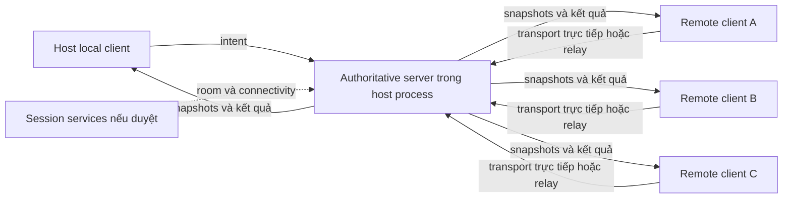

# Kiến trúc và lựa chọn networking

Ngày kiểm tra nguồn: **2026-11-01** (Asia/Bangkok). Đây là design/assessment **PROPOSED**, chưa phải code, package inventory hay framework approval. Unity/C# và host topology là CONFIRMED theo [SRS](../Long_document/srs.md); exact versions/services chưa chọn. Implementation TODO. [Roadmap](ROADMAP.md) điều phối thí nghiệm sớm F-003, [protocol](PROTOCOL.md) và [testing](TESTING.md) là planned contracts/evidence.

## Topology và ranh giới trust

Server authority quyết định luật; transport chuyển packets; session services giúp membership/room code/connectivity. Relay chỉ forward traffic, không validate hit/HP hay biến host thành trusted dedicated server. Host local client phải đi cùng validation path với remote; người sửa host process vẫn có thể gian lận. Demo không hứa chống host tampering, không cần thuê dedicated hosting. Headless server là artifact/test execution mode chạy cùng authority rules, không đổi main demo host+3.

Room là nhóm membership trước/sau game; match là một lượt có matchId, contenders và terminal result; session là vòng đời kết nối host cùng participants. Room owner được yêu cầu start; server mới quyết định đủ điều kiện. Connection ID không phải participant identity. Eliminated và disconnected không đồng nghĩa đã rời room.

## Responsibility và state ownership dự kiến

| Owner logic | Trách nhiệm | Ràng buộc |
| --- | --- | --- |
| Local input/camera adapter | Bind chỉ avatar được local participant sở hữu; đọc keyboard/LMB/E, camera follow fixed heading | Remote prefab không đọc input/camera/audio listener; ownership đổi sau reconnect phải rebind một lần |
| Server participant/session coordinator | Identity binding, connection generation, room capacity/loading/start/admission, grace/forfeit, abort | Không dùng room code làm identity proof; session service auth không tự phục hồi gameplay |
| Server motor | Movement/facing/jump, terrain/wall collisions, knockback và boundary state | Chỉ nhận intent bounded; server không nhận client pose như truth |
| Server combat/health | Attack timing/cooldown/geometry/occlusion, hit dedup, damage/HP | Server sở hữu HP là chưa đủ nếu tin client position hoặc claim hit |
| Server weapon owner | Available/held/dropped, atomic pickup contention, modifiers | Không hai owners hoặc inventory stack; E drop khác auto contact pickup |
| Server match rules | Batch unified elimination, contender removal, time/outcome; distinct Finished/Aborted | Resolve toàn step trước result; spectator vẫn participant nhưng không contender |
| Client presentation | Snapshot/interpolation, attack feedback, HUD/spectator/errors | Không tự damage/award weapon/decide winner; predicted visual phải sửa theo server |

Các responsibility này không ép tên class, singleton, ECS hay microservices. Một Unity project và server logic C# dùng chung là hướng đủ nhỏ; không database/REST/progression backend khi chưa có nhu cầu. Scene/prefab boundaries phải chốt từ project thật, không suy từ layout dự kiến.

Terrain/walls ảnh hưởng grounding, jump, obstruction, displacement; knockback có thể dừng ở wall hoặc đưa qua ring-out boundary. Hai rigid-body worlds khác nhau không mặc nhiên deterministic. Server simulate/validate movement và phát state; interpolation remote pose có thể giảm jitter nhưng không thay collision truth. Local prediction/reconciliation chỉ cân nhắc khi F-003/F-015 đo input-to-response/correction không đạt budget đã duyệt. Đo drift, correction distance, hit disagreement và wall penetration dưới delay/jitter/loss trước khi chọn controller/physics/tick/prediction. Bounded lag compensation là proposal riêng, không mặc định tin timestamp client.

## NGO và Mirror — đánh giá ngắn

Mọi selection dưới đây PROPOSED. Nguồn chính thức được mở/đọc ngày 2026-11-01; documentation support không phải installed/build evidence.

| Concern | NGO + Unity Transport + MPS/Relay | Mirror |
| --- | --- | --- |
| Editor compatibility | [NGO 3.1 manual](https://docs.unity3d.com/Packages/com.unity.netcode.gameobjects@3.1/manual/index.html) nêu Unity 6.0+ và Windows/Linux/macOS. [Unity support](https://unity.com/releases/unity-6/support) nêu 6.3 LTS tới Dec-2027; 6.3 LTS là candidate cần pin patch/test | [Official repo](https://github.com/MirrorNetworking/Mirror) Getting Started liệt kê tới 6000.1, không đủ chứng minh selected 6.3 patch; compatibility 6.3 của exact release UNVERIFIED, cần release review và clean build |
| Host/client/headless | NGO client-server gameplay với Unity host; [Unity Dedicated Server](https://docs.unity.com/en-us/engine/6000.3/manual/platform-specific/dedicated-server) là build target cho headless, compatibility thực phải test | [Mirror general](https://mirror-networking.gitbook.io/docs/manual/general) mô tả client/server/host; headless use cần chọn release/build setup và smoke-run, chưa được xác minh trong checkout |
| Authority/movement | GameObject replication/RPC, server-owned movement path phải thiết kế; [Network physics](https://docs.unity3d.com/Packages/com.unity.netcode.gameobjects@3.1/manual/advanced-topics/physics.html) làm nguồn thí nghiệm physics, không bảo đảm motor competitive | Repo có RPC/SyncVars/authority options; [Network Transform](https://mirror-networking.gitbook.io/docs/manual/components/network-transform) sync pose và snapshot interpolation. Component client authority không đáp ứng movement validation nếu bật rồi tin pose |
| Internet/private room | [MPS sessions](https://docs.unity.com/en-us/mps-sdk/sessions-overview), [join by code](https://docs.unity.com/en-us/mps-sdk/join-session), [Relay](https://docs.unity.com/en-us/mps-sdk/networking/relay-servers) cung cấp đường room/connectivity; cần config private/capacity/lock in game | Multiple transports theo repo; direct sockets không tự vượt NAT. Join-code directory và relay/provider cần chọn/test riêng; không giả định Mirror core cung cấp room service miễn phí |
| Reconnect | MPS reconnect chỉ khi còn membership; không khôi phục HP/avatar/state thay game. Cần identity proof, generation, snapshot và grace của protocol | Core framework không đủ quyết định participant identity/state restoration; cần custom binding/approved auth/transport service. Chi tiết release reconnect APIs UNVERIFIED |
| Impairment | [Unity Network Simulator](https://docs.unity3d.com/Packages/com.unity.multiplayer.tools@2.2/manual/network-simulator.html) dùng UTP pipeline cho delay/jitter/loss/disconnect; chọn compatible package sau | [Latency Simulation Transport](https://mirror-networking.gitbook.io/docs/manual/transports/latency-simulaton-transport) wrap transport, hỗ trợ delay/loss/reorder; phải ghi profile và actual RTT |
| CI/license | Unity Editor build client/server cần runner/module/license/activation plan; không tự phát sinh CI pipeline | Cùng Unity licensing/build constraints; Mirror MIT không thay Unity Editor license |
| Cost/ops | Managed services giảm việc tự làm room/relay nhưng có usage billing/quota/rate limit và outage dependence; cần project owner, budget alert và vùng relay | [MIT license trong official repo](https://github.com/MirrorNetworking/Mirror/blob/master/LICENSE) cho thư viện; third-party transport/service có điều khoản riêng, self-host có network/ops cost |

**Khuyến nghị PROPOSED:** NGO + Unity Transport + MPS sessions/Relay, trên candidate Unity 6.3 LTS patch sau compatibility check. Lý do là đường official cho GameObjects, room code và internet relay giảm phần connectivity tự xây cho ba sinh viên; đây là suy luận về fit, không benchmark cho rằng NGO nhanh hơn Mirror. Chọn đúng một framework sau TECH-001; Mirror là phương án thay thế nếu service/compatibility/latency spike cho thấy hướng đầu không phù hợp, không implement cả hai.

[NGO client anticipation](https://docs.unity3d.com/Packages/com.unity.netcode.gameobjects@3.1/manual/advanced-topics/client-anticipation.html) cần phân biệt với prediction/reconciliation đầy đủ; không gọi bật smoothing là giải quyết latency/hit fairness. Tài liệu `latest` đã trỏ tới 3.1 khi đọc; 3.1 là phiên bản nguồn tham khảo, **chưa pin/chưa duyệt/chưa cài**. Versions UTP/MPS/tools và URP/Input/Cinemachine exact patches UNDECIDED, phải xem dependency thực trong clean project.

## Pricing, quota và license evidence

Các claim dưới đây kiểm tra ở nguồn official ngày 2026-11-01, không phải giá đã cam kết cho project. Trước provisioning phải owner review lại Dashboard/region/terms và đặt ngân sách. Không cấp dịch vụ trả tiền trong task này.

- [UGS pricing](https://unity.com/products/gaming-services/pricing): Relay free tier ghi 50 average monthly CCU, bandwidth 3 GiB/CCU tối đa 150 GiB/tháng; phần vượt ghi $0.16/additional average CCU, $0.09/GiB US/EU hoặc $0.16/GiB Asia/Australia. Lobby bandwidth free 10 GiB/tháng mỗi regional group, phần vượt cùng hai regional rates. Không suy “bốn người luôn miễn phí”; aggregate usage/bandwidth/organization và service limits phải kiểm tra.
- Request rate limits, session disconnect expiry, allocation lifetime và quota Dashboard áp dụng cho project cụ thể: **UNVERIFIED**, chưa có service project/config/traffic để chứng minh. TECH-001 phải đối chiếu service limit docs và load budget trước dùng. Không nhập database/concurrency/retention assignment vào capacity plan.
- [Unity license compliance](https://unity.com/pages/license-compliance) ghi Personal eligibility threshold $200,000 Total Finances trong 12 tháng gần nhất và build machine cần license riêng; không khẳng định nhóm tự động đủ điều kiện hoặc một key dùng chung CI. Đây là constraint cần owner/license administrator review, không phải tư vấn entitlement đã xác nhận.
- [Unity floating license docs](https://docs.unity.com/licensing/en-us/manual) mô tả license server/client; không bắt buộc nhóm mua Build Server. License tier/runner activation route, cost runner/artifact storage/GitHub quota và khả năng dùng school entitlements còn **UNVERIFIED**. F-018 bị chặn nếu chưa có route hợp lệ.
- Mirror core MIT không thu service quota từ thư viện; giá/quota của relay provider cho Mirror chưa chọn là **UNVERIFIED**, không tuyên bố free internet rooms. Cost còn gồm công cấu hình port/relay/auth và duy trì dịch vụ.

Không yêu cầu user registration UI. Anonymous service authentication/participant credential là PROPOSED phục vụ identity/connectivity/reconnect, không user account product feature. Credential storage/expiry/recovery và privacy/log redaction cần review; room code không đủ chứng minh quay lại đúng participant.

## Spike và phê duyệt kế tiếp

TECH-001 review exact Editor/framework/transport/services/modules, approval evidence và license/cost plan. F-001 tạo reproducible skeleton sau authorized feature branch; F-003 kiểm hai instances trước, rồi host+3 trên ít nhất hai mạng thật, input ownership/local camera, server correction, reconnect feasibility và host loss. Giữ topology/log/version/actual failure. LAN/local multi-instance không thay WAN evidence. Không thuê dedicated host hoặc thêm database để vượt blocker khi chưa có nhu cầu/approval.

## Assignment reuse có giới hạn

Đã đọc bằng `git show` trên assignment commit `f4835ce35aea6bff79ce5fcd266813abb3c733bd`: `assignment/AD-065/README.md`, `implementation/CONTRACT.md`, `src/application.mjs`, `src/domain.mjs`, `src/combat.mjs`, `verification-summary.md`. Đây là Node.js/SQLite slice; source/contract cho thấy ownership-before-replay, dedup command, HP clamp/terminal rejection; recorded audit là historical self-report, không rerun trong task này.

Có thể chuyển **ý tưởng/test scenario** sang TC-107/108/112/117: remote không chọn actor/damage; replay không damage lần hai; HP không âm; contender removal/outcome idempotent. Source không chứng minh real 3D geometry/cooldown/network sessions/reconnect hoặc Unity motor. Không copy code/cherry-pick, không chọn HTTP/SQLite/backend từ slice; không nhập concurrency/retention/response SLA assignment. Các Godot/.NET và Go refs tồn tại nhưng không là nền Unity đã duyệt, không audit rộng chúng. Nền được owner duyệt là setup commit `1d7a6c9` với tài liệu có sẵn, không phải prototype import.
