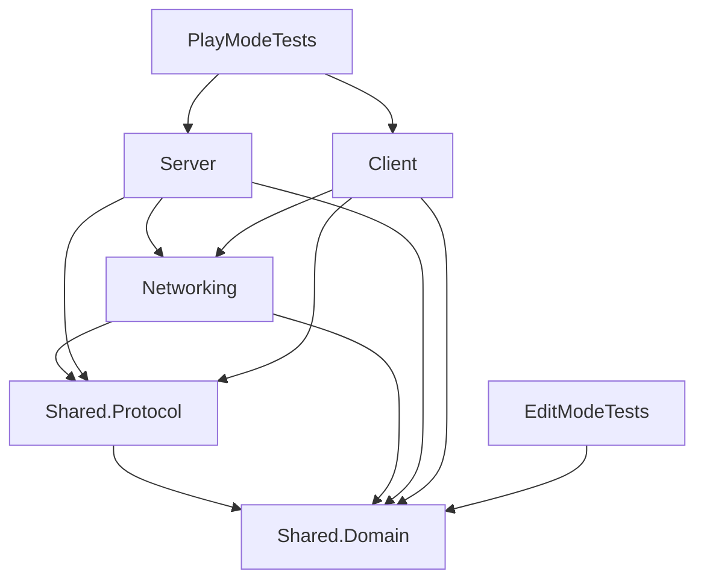

# Kiểm toán main và di trú MVP offline

## Nguồn đã đối chiếu

- Nhánh `feature/tv1-m1-migration` bắt đầu tại main `adedfa17ab694a2300ea0735b5e8fda14102e362`, PR #2 “Khởi tạo cấu trúc và tài liệu dự án SE2026-T17”. Main là scaffold, chưa chứa gameplay, asmdef, scene, Packages hoặc ProjectSettings.
- Đã đọc README, toàn bộ tài liệu main trong `docs/` và `.github/workflows/README.md`, cùng mô tả merge trong lịch sử Git. Không tìm thấy `SE2026-T17-Huong-dan-va-phan-cong-nhom.md` hoặc mẫu mô tả PR riêng trên main này.
- MVP offline được phục hồi từ `9eed902` của `feature/system-platform-networking`: project Unity thật, package lock, Mirror đã cài, tài nguyên, test và công cụ. Không dùng cache làm nguồn chính, không dùng prototype NGO cũ ở `c7fbd30`.
- Tài liệu host/FFA ở nhánh roadmap khác chỉ được đối chiếu, không tự ghép thành quyết định main. Phân công TV1–TV3 và hướng dedicated server theo yêu cầu hiện tại của người dùng.

## Bản đồ di trú

| Thành phần | Đường dẫn cũ dưới Assets/_Project | Đường dẫn hiện tại |
| --- | --- | --- |
| GameManager | Scripts/Core/GameManager.cs | Scripts/Server/Simulation/GameManager.cs |
| OfflineMatchReadinessProbe | Scripts/Core/OfflineMatchReadinessProbe.cs | Scripts/Server/Simulation/OfflineMatchReadinessProbe.cs |
| IMatchReadinessProbe | Scripts/Core/IMatchReadinessProbe.cs | Scripts/Shared/Domain/IMatchReadinessProbe.cs |
| CombatController | Scripts/Player/CombatController.cs | Scripts/Server/Combat/CombatController.cs |
| WeaponPickup | Scripts/Pickups/WeaponPickup.cs | Scripts/Server/Combat/WeaponPickup.cs |
| PlayerController | Scripts/Client/Input/PlayerController.cs | Scripts/Client/Presentation/PlayerController.cs |
| Player, Bot prefab | Prefabs/Player.prefab, Prefabs/Bot.prefab | Prefabs/Characters/Player.prefab, Prefabs/Characters/Bot.prefab |
| Pickup prefab | Prefabs/WeaponPickup.prefab | Prefabs/Combat/WeaponPickup.prefab |

Cả chín asset giữ nguyên GUID. Health đã ở Server/Combat; input, camera và UI tiếp tục ở Client. Test vẫn ở Tests/EditMode và Tests/PlayMode nhưng đã đổi đường dẫn tải prefab. Thư mục legacy chỉ chứa placeholder được loại bỏ sau khi xác nhận không còn code/scene/prefab chưa di trú. Cấu trúc scaffold chính thức và plugin giữ nguyên.

## Ranh giới biên dịch

Domain chứa trạng thái, hợp đồng đọc HUD và participant kết thúc trận. Protocol chứa hợp đồng ý định input/readiness độc lập engine. Server nhận interface thay vì tham chiếu PlayerInputHandler/PlayerController/MatchUI cụ thể. MatchUI chỉ quan sát và điều hướng scene. Các adapter Client tự thực hiện lệnh kết thúc qua hợp đồng Shared.

`SmallArena.Runtime` cũ được loại bỏ; thêm `SmallArena.Shared.Protocol`, tổng cộng vẫn bảy asmdef. Domain/Protocol bật noEngineReferences và chặn plugin tự động. Server và Client không tham chiếu nhau. Namespace `SmallArena.Core`, `SmallArena.Player`, `SmallArena.Pickups` được giữ để tránh đổi API không cần thiết; mã thực tế thuộc asmdef Server theo vị trí mới. Định danh assembly trong scene đã cập nhật.

## Bảo toàn hành vi và phạm vi TV1

Giữ WASD 5 m/s, giới hạn chéo, nhảy grounded khoảng 1,2 m; camera LateUpdate yaw cố định; J mới/cooldown 0,5 s, sphere bán kính 0,6 m chỉ Bot Layer 8; Health 10 HP/clamp/chết một lần; E ở khoảng cách tâm ≤1,5 m, nhặt một lần Layer 9, buff 1→2; Victory/HUD/event cleanup; Main Menu và replay/reset. MainMenu/Bootstrap/Arena_MVP ở index 0/1/2.

Đây là mẫu offline chạy các module cùng tiến trình. Di chuyển local còn là adapter mẫu; hợp đồng input/readiness không chứng minh tính hợp lệ của lệnh mạng. Chưa có NetworkPlayer, NetworkStartPosition, spawn mạng, lobby, reconnect hoặc kiểm chứng nhiều client. Bootstrap giữ standard Mirror NetworkManager/KCP, chưa tự tạo network player. Không loại Server khỏi build offline vốn cần logic cục bộ; tách asmdef không đồng nghĩa dedicated server đã hoàn tất.

TV1 triển khai tiếp kết nối → spawn → ownership → gửi ý định/xác thực server → hai client quan sát, rồi lobby/reconnect. TV2 sở hữu combat/xác thực; TV3 sở hữu input, presentation, UI và scene/prefab. Không tạo NetworkPlayer dạng god class.

## Ngữ cảnh và bằng chứng

`PROJECT_CONTEXT.md` (cục bộ, không tracked) là ngữ cảnh tiếng Việt duy nhất; AGENTS.md chỉ dẫn agent đọc và cập nhật nó. Kết quả hiện hành ở [migration-results.md](../testing/migration-results.md); dữ liệu thô ở TestResults/Logs không commit.
