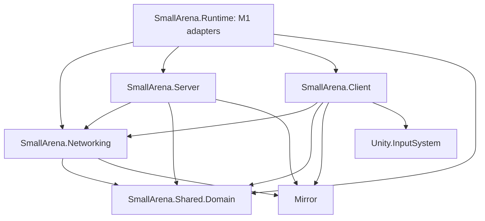

# Task 0.1: Server-authoritative assembly baseline

Production dependencies point toward shared contracts:



- **Shared.Domain** contains the existing pure C# match state and readiness rules. It has no assembly references, disables engine references and automatic plugin references. The existing `SmallArena.Domain` C# namespace is preserved for source compatibility; the assembly is now `SmallArena.Shared.Domain`.
- **Networking** owns future Mirror bridges, protocol adapters and connection contracts. It must not reference Server, Client or Runtime. Future NetworkPlayer components only forward intents and replicated state; validation, simulation and combat belong to Server services.
- **Server** has separate Simulation, Sessions, Validation and Combat directories. They are placeholders for authoritative systems, not implemented gameplay.
- **Client** owns the existing PlayerInputHandler, plus Networking, Presentation and UI directories. The input script retains its GUID and namespace so M1 scene references survive the move.
- **Runtime** retains the M1 GameManager and readiness interface. Task 2.3 adds the local CombatController here as a composition adapter referencing Client input and Server Health. Neither Server nor Client references Runtime or each other, so the dependency graph remains acyclic. Local direct damage is an offline prototype; network command validation and authoritative combat resolution remain Server responsibilities.
- **Tests** remain separate, with NUnit restricted to test assemblies. PlayMode tests explicitly reference Client for the moved input adapter. Domain tests target the renamed pure assembly.

All moved assets retain their metadata GUIDs. Bootstrap's existing GUID is also retained. README assets retain otherwise empty directory leaves in Git.

## Bootstrap

Enabled build scenes are Bootstrap at index 0 and Arena_MVP at index 1. Bootstrap contains one `_NetworkManager` object with standard Mirror NetworkManager and KcpTransport components, linked through the manager's transport field. Offline scene is Bootstrap; online scene is Arena_MVP; UDP port is 7777. The manager persists across scene changes. Headless builds start as a dedicated server; Editor autostart is disabled.

Player auto-creation is disabled because this baseline has no network player prefab. Interactive connection UI, authentication, network spawning and authoritative gameplay are later roadmap work. Starting the editor in Bootstrap does not automatically connect a client. Arena_MVP is preserved without scene edits.

Mirror 96.0.1 is installed in `Assets/Mirror`. Terrain and Particle System modules are required by its core; AI and Unity Web Request are required by its installed examples/transports. The built-in modules are declared in the package manifest rather than patching vendor source.

## Reproducible verification

Run from the repository root with PowerShell:

```powershell
powershell -NoProfile -ExecutionPolicy Bypass -File tools/Verify-Scaffold.ps1 -CompileProbes
powershell -NoProfile -ExecutionPolicy Bypass -File tools/Run-DomainTests.ps1
```

The scaffold check enforces the seven project asmdefs, exact dependency directions, absence of project cycles, domain isolation, folder metadata, and enabled scene order/GUIDs. It accepts vendor asmdefs alongside project assemblies. The independent Roslyn compiler builds installed Mirror core sources and all seven project assemblies, preserving nearest-asmdef source ownership. It treats project warnings as errors. Results go to ignored `TestResults/` or `Logs/` directories. These checks do not execute Mirror's Unity weaver or prove a multiplayer session works.

For native import and Mirror weaving, use Unity 6000.6.7f1:

```powershell
& 'C:/Program Files/Unity/Hub/Editor/6000.6.7f1/Editor/Unity.exe' -batchmode -nographics -quit -projectPath (Get-Location).Path -logFile "$PWD/Logs/Task01-Unity.log"
```

## Local results (2026-11-02)

- Independent compilation passed for all seven project assemblies plus Mirror core and its compiler-symbol assembly. Domain engine-access rejection and its positive control passed.
- All 34 domain NUnit cases passed. The compiled domain references only `System.Runtime` and `System.Threading`.
- Exact project dependency directions and cycle detection passed. Scene paths, enabled indices, metadata GUIDs, Mirror component references and required directories passed.
- Unity's native compilation and Mirror weaving completed successfully after enabling the missing built-in modules. Vendor analyzer warnings remain in Mirror code; no compiler errors were reported in the successful run. See `Logs/Task01-Unity-Modules.log`.
- Arena_MVP and Bootstrap's metadata GUID have no content diff. Architecture changes pass `git diff --check`; pre-existing material whitespace is outside this change.
- Full short Git status is saved to `TestResults/Task01/git-status.txt`. Moved files appear as deletions plus untracked destinations until staged. Nothing has been staged or committed.

Unity's Mirror editor integration also generated `Assets/ScriptTemplates`, which appears as untracked alongside the newly installed Mirror package. Pre-existing material, sample profile, project setting, package and Mirror installation changes remain in the working tree and should be reviewed separately from the architecture migration. Native PlayMode execution and a live multiplayer session were not part of these local checks.
